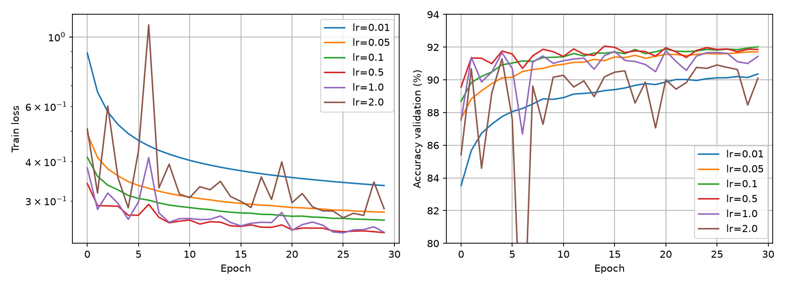
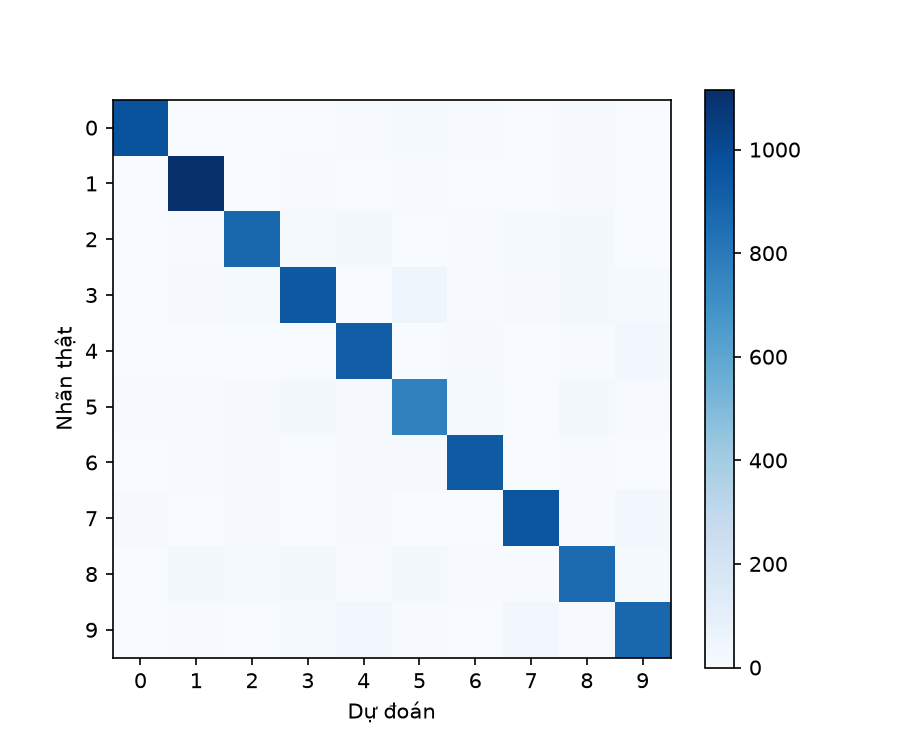
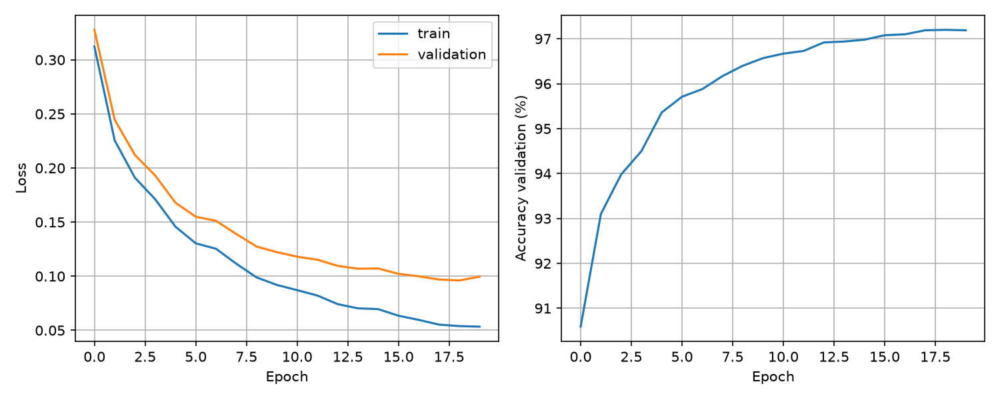
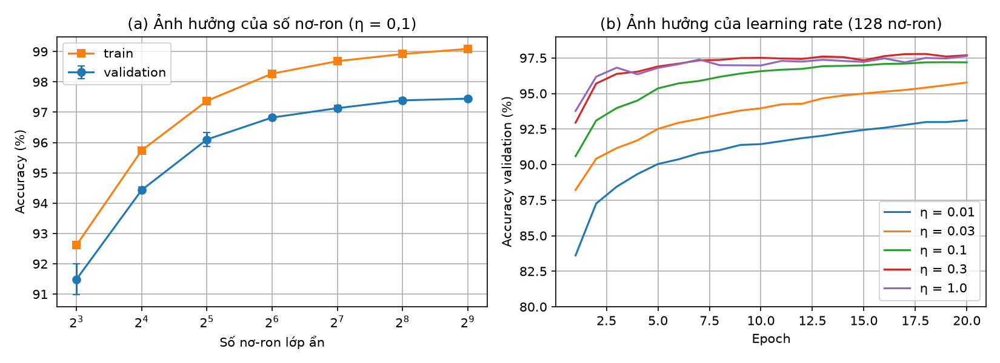
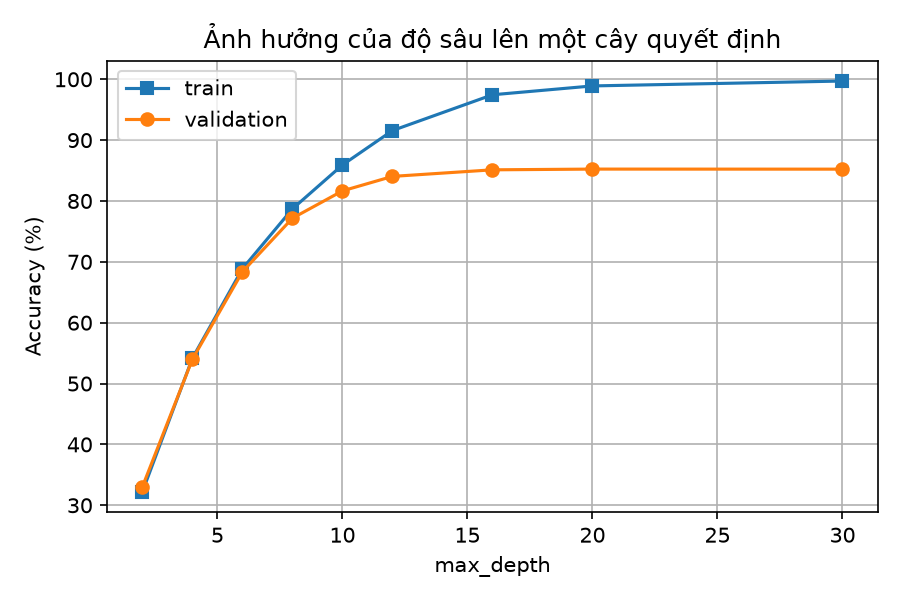
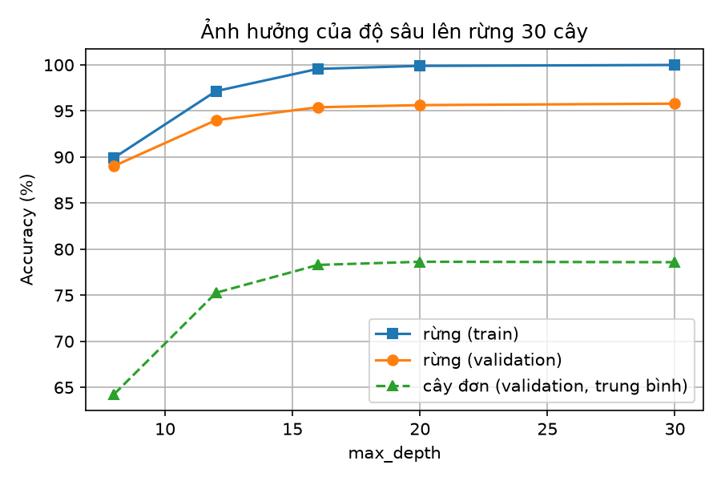
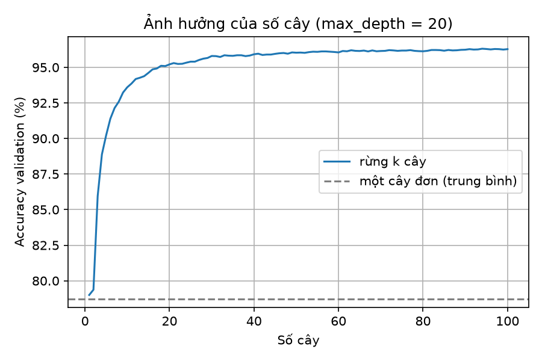
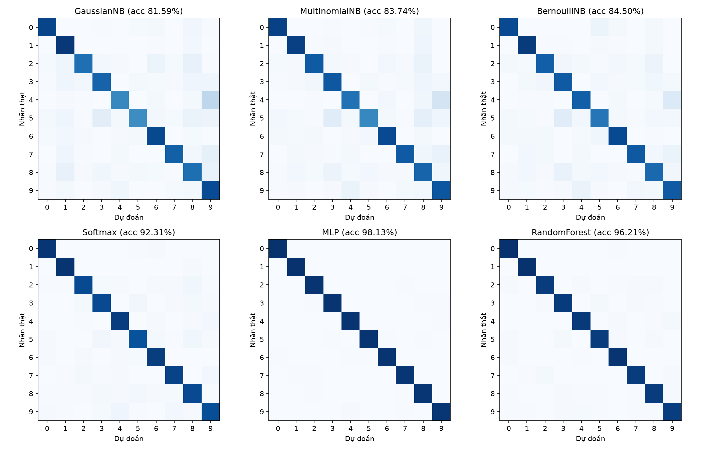
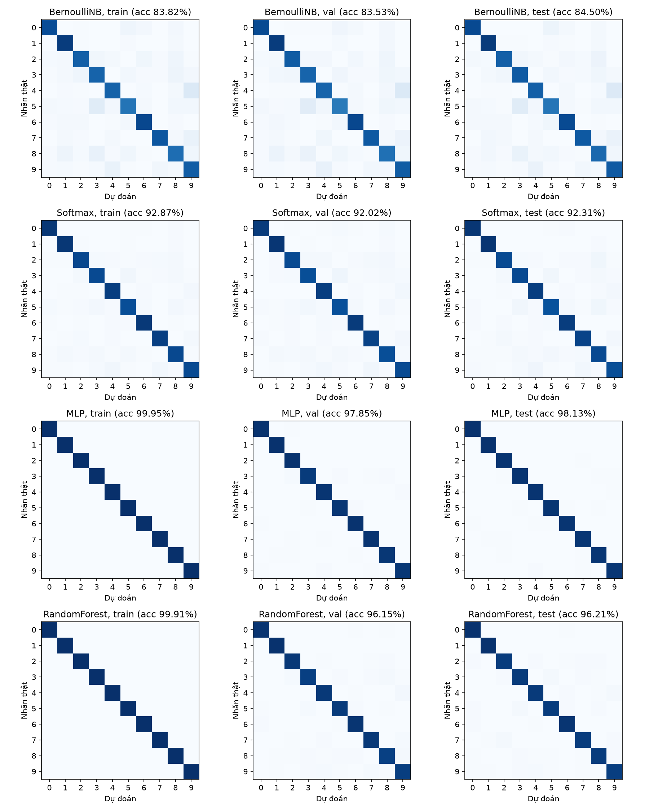
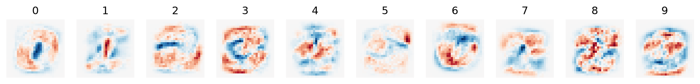

# Báo cáo đồ án 1: Nhận dạng chữ số viết tay bằng các phương pháp phân lớp
# Nhận dạng chữ số viết tay MNIST bằng các phương pháp phân lớp

Đồ án giữa kỳ, môn Nhận dạng, Khoa Toán-Tin học, Trường Đại học Khoa học Tự nhiên, ĐHQG-HCM

Nhóm: [Họ tên, MSSV của từng thành viên]
Mã nguồn: [link GitHub]
Ngày nộp: [ngày]

## Giới thiệu

Nhận dạng chữ số viết tay là bài toán phân lớp chuẩn để so sánh các phương pháp học máy. Chúng tôi dùng tập MNIST [1] gồm 70.000 ảnh xám 28×28 của các chữ số 0 đến 9 để cài đặt từ đầu và so sánh bốn nhóm bộ phân lớp: Naïve Bayes (ba biến thể Gaussian, Multinomial và Bernoulli [2]), softmax regression huấn luyện bằng gradient descent, mạng neuron nhiều lớp (MLP) huấn luyện bằng lan truyền ngược [3] với khởi tạo He [4], và Random Forest [5, 6]. Phần tính toán lõi của mọi mô hình được cài bằng NumPy [7]; scikit-learn [8] và PyTorch [9] chỉ dùng để tải dữ liệu và đối chiếu kết quả, đúng như đề cho phép.

Các nội dung chính của báo cáo: (i) cài đặt và kiểm chứng từng mô hình (so với scikit-learn, đạo hàm số hoặc PyTorch); (ii) khảo sát ảnh hưởng của siêu tham số lên MLP và Random Forest bằng tập validation; (iii) đánh giá cuối cùng trên tập test, một lần duy nhất, kèm thời gian huấn luyện và dự đoán đo thống nhất; (iv) thảo luận ưu nhược điểm của từng phương pháp; (v) kiểm tra khả năng chuyển cấu hình sang Fashion-MNIST [10].

Báo cáo gồm: dữ liệu và độ đo (mục 1 đến 3), các phương pháp và thí nghiệm (mục 4 đến 9), so sánh và thảo luận (mục 10), mở rộng sang Fashion-MNIST (mục 11), kết luận, khai báo sử dụng AI, phân công công việc và tài liệu tham khảo.
## 1. Dữ liệu [1]

MNIST gồm 70.000 ảnh xám kích thước 28×28 của các chữ số từ 0 đến 9, trong đó có 60.000 ảnh huấn luyện và 10.000 ảnh kiểm thử. Chúng tôi tách 10.000 ảnh từ tập huấn luyện làm tập validation bằng hoán vị ngẫu nhiên với seed cố định 42, nên mọi thí nghiệm dùng chung cách chia 50.000 (train) / 10.000 (validation) / 10.000 (test).

Mỗi ảnh được làm phẳng thành vector 784 chiều và chuẩn hoá bằng cách chia cho 255 để đưa giá trị pixel về đoạn [0, 1]. Phép chia này dùng hằng số cố định, không dùng thống kê của tập nào, nên không gây rò rỉ dữ liệu (data leak) từ tập test.

## 2. Khám phá dữ liệu

Số mẫu mỗi lớp trong tập train dao động từ 4543 đến 5600 (xem hình bên dưới), tức các lớp gần cân bằng nên accuracy là độ đo hợp lý. Có khoảng 80,9% pixel bằng 0, và có 71 pixel luôn bằng 0 trên toàn tập train (phương sai bằng 0), nên khi cài Gaussian Naïve Bayes phải cộng một hằng số nhỏ ε vào phương sai để tránh chia cho 0.

## 3. Độ đo đánh giá

Chúng tôi tự cài confusion matrix bằng `np.bincount` và suy ra accuracy, precision, recall, F1 (macro) từ ma trận này. Kết quả được đối chiếu với scikit-learn trên dữ liệu ngẫu nhiên và khớp hoàn toàn (xem `tests/test_metrics.py`).
## 4. Gaussian Naïve Bayes

**Mô hình.** Giả sử các pixel độc lập có điều kiện theo lớp và mỗi pixel i của lớp c có phân phối chuẩn N(μ_ci, σ²_ci). Dự đoán chọn lớp cực đại hoá

log P(c) − ½ Σ_i log(2π σ²_ci) − ½ Σ_i (x_i − μ_ci)² / σ²_ci

**Huấn luyện.** Với mỗi lớp, tính prior, trung bình và phương sai từng pixel; cộng ε = var_smoothing × max(Var(X)) vào phương sai để tránh chia cho 0 vì có 71 pixel luôn bằng 0.

**Kết quả.** Với var_smoothing = 1e-9, accuracy validation là 57.6% (train 57.67%). Thời gian huấn luyện 0.437 s, dự đoán 0.575 s. Sau khi quét var_smoothing (hình bên dưới), giá trị 0.1 cho accuracy validation 79.78%. Kết quả đã được đối chiếu và khớp với sklearn (tham số và dự đoán).

**Nhận xét.** Accuracy thấp vì giả định độc lập giữa các pixel và phân phối chuẩn không đúng với ảnh chữ số: các pixel lân cận có tương quan mạnh, và giá trị pixel gần như nhị phân. Ưu điểm: huấn luyện rất nhanh (một lượt qua dữ liệu), dễ giải thích (mỗi lớp là một ảnh trung bình kèm độ phân tán).

## 5. Multinomial và Bernoulli Naïve Bayes [2]

**Mô hình.** Multinomial NB coi giá trị pixel là số lần xuất hiện: θ_ci = (Σ x_i trong lớp c + α) / (Σ_i Σ x_i trong lớp c + α·d), và dự đoán chọn lớp cực đại hoá log P(c) + Σ_i x_i log θ_ci. Bernoulli NB nhị phân hoá pixel bằng ngưỡng 0,5, với p_ci = (số mẫu lớp c có pixel i sáng + α) / (số mẫu lớp c + 2α), và cực đại hoá log P(c) + Σ_i [x_i log p_ci + (1 − x_i) log(1 − p_ci)]. Cả hai đều dùng làm mịn Laplace với hệ số α để tránh log 0.

**Kết quả.** Với α = 1, Multinomial đạt 82,29% trên validation (train 82,45%, F1 macro 82,11%), Bernoulli đạt 83,36% (train 83,63%, F1 macro 83,13%). Thời gian huấn luyện lần lượt là 5,65 s và 2,49 s, dự đoán trên 10.000 ảnh validation là 0,023 s và 0,025 s. Khi quét α (hình bên dưới), giá trị tốt nhất của Multinomial là α = 1e-4 cho 82,38%, của Bernoulli là α = 1e-3 cho 83,53%. Kết quả đã được đối chiếu với sklearn: ma trận log xác suất đặc trưng của Multinomial NB trùng tuyệt đối (lệch tối đa 0), của Bernoulli NB lệch tối đa 1,8 × 10⁻¹⁵ (sai số làm tròn float64), log prior trùng khớp, và dự đoán trên validation trùng 100%.

**Nhận xét.** Accuracy của cả hai mô hình gần như không phụ thuộc vào α: trên toàn bộ khoảng α từ 1e-4 đến 10, Multinomial chỉ dao động từ 82,06% đến 82,38% (biên độ 0,32 điểm phần trăm) và Bernoulli từ 83,12% đến 83,53% (biên độ 0,41 điểm). Accuracy giảm rất nhẹ và đều khi α tăng, và đỉnh nằm ở α nhỏ (1e-4 đến 1e-3). Điều này trái với Gaussian NB, vốn rất nhạy với hệ số làm mịn (57,60% lên 79,78%). Một cách giải thích hợp lý là mỗi lớp có khoảng 5.000 mẫu nên số đếm của hầu hết pixel đủ lớn để α ≤ 10 gần như không đổi xác suất; α chỉ có tác dụng với số ít pixel hiếm khi sáng (vùng viền ảnh).

Cả hai mô hình tốt hơn Gaussian NB sau khi đã tinh chỉnh (79,78%), với Bernoulli hơn khoảng 3,7 điểm và Multinomial hơn khoảng 2,6 điểm, vì giá trị pixel MNIST gần như nhị phân, nên mô hình "sáng hay tối" hợp với dữ liệu hơn phân phối chuẩn. Bernoulli cao hơn Multinomial khoảng 1 điểm, phù hợp với việc nó còn dùng thông tin từ các pixel tối (phạt khi pixel tối ở nơi lớp đó thường sáng), trong khi Multinomial chỉ khai thác pixel sáng. Chênh lệch train và validation nhỏ (dưới 0,3 điểm) cho thấy hai mô hình không quá khớp mà bị giới hạn bởi giả định độc lập có điều kiện giữa các pixel.
**Pseudocode (Naïve Bayes).**

    HUẤN_LUYỆN(X, y):
        với mỗi lớp c:
            prior_c ← (số mẫu thuộc lớp c) / N
            Gaussian:  μ_c, σ²_c ← trung bình và phương sai từng pixel của lớp c;
                       σ²_c ← σ²_c + ε
            Multinomial: n_ci ← tổng giá trị pixel i trong lớp c;
                       θ_ci ← (n_ci + α) / (Σ_i n_ci + α·d)
            Bernoulli:   n_ci ← số mẫu lớp c có pixel i sáng (> 0,5);
                       p_ci ← (n_ci + α) / (số mẫu lớp c + 2α)

    DỰ_ĐOÁN(x):
        với mỗi lớp c:  s_c ← log prior_c + Σ_i log P(x_i | c)
        trả về argmax_c s_c

## 6. Softmax Regression (bộ phân lớp tuyến tính)

**Mô hình.** Với ma trận đặc trưng X (N × 784), tham số W (784 × 10) và b (10), điểm số là Z = XW + b, xác suất lớp là P = softmax(Z), trong đó P_nc = exp(Z_nc) / Σ_j exp(Z_nj). Hàm mất mát là cross-entropy trung bình L = −(1/N) Σ_n Σ_c Y_nc log P_nc, trong đó Y là mã one-hot của nhãn.

**Gradient.** Với một mẫu, L_n = −Σ_c Y_c (Z_c − log Σ_j e^{Z_j}); do Σ_c Y_c = 1, đạo hàm theo Z_k là P_k − Y_k. Do đó ∂L/∂Z = (P − Y)/N, ∂L/∂W = Xᵀ(P − Y)/N và ∂L/∂b = tổng các hàng của (P − Y)/N. Khi thêm phạt L2 (λ/2)‖W‖², gradient theo W cộng thêm λW.

**Ổn định số.** Trước khi lấy exp, trừ max của từng hàng của Z, và tính log P qua Z − logsumexp(Z), để tránh tràn số và log(0).

**Kiểm chứng gradient.** Chúng tôi so sánh gradient giải tích với đạo hàm số (sai phân trung tâm, ε = 1e-5) trên 20 mẫu ngẫu nhiên, 300 phần tử ngẫu nhiên của W và toàn bộ b. Sai số tương đối tối đa là 1.22e-07 (λ = 0) và 3.43e-07 (λ = 0,1), tức gradient được cài đúng. Với W = 0, loss khởi đầu bằng 2.3025850929940463 ≈ ln 10 = 2,3026 như lý thuyết.
**Huấn luyện.** Chúng tôi dùng mini-batch gradient descent, kích thước batch 128, 30 epoch, khởi tạo W = 0 và b = 0 (hợp lệ vì bài toán lồi), xáo trộn thứ tự mẫu mỗi epoch. Pseudocode:

    khởi tạo W = 0, b = 0
    lặp epoch = 1..E:
        hoán vị ngẫu nhiên các mẫu huấn luyện
        với mỗi mini-batch (X_B, Y_B):
            tính P = softmax(X_B W + b)
            dW = X_Bᵀ (P − Y_B) / |B| ,  db = tổng các hàng của (P − Y_B) / |B|
            W ← W − η dW ,  b ← b − η db

**Ảnh hưởng của learning rate.** Chúng tôi quét η ∈ {0,01; 0,05; 0,1; 0,5; 1,0; 2,0} với 30 epoch (hình bên dưới). Kết quả ở epoch cuối:

| η | Accuracy validation | Train loss | Validation loss |
|---|---|---|---|
| 0,01 | 90,36% | 0,3357 | 0,3530 |
| 0,05 | 91,71% | 0,2761 | 0,3078 |
| **0,1** | **92,02%** | 0,2604 | **0,2997** |
| 0,5 | 91,86% | 0,2375 | 0,3037 |
| 1,0 | 91,43% | 0,2381 | 0,3239 |
| 2,0 | 90,10% | 0,2831 | 0,4087 |

Với η = 0,01, train loss cuối còn 0,3357, cao nhất trong các giá trị từ 0,01 đến 1,0, cho thấy bước nhảy quá nhỏ nên 30 epoch chưa đủ để hội tụ. Các giá trị η từ 0,05 đến 1,0 cho accuracy 91,43-92,02%. Ở η = 0,5 và 1,0, train loss thấp hơn η = 0,1 (0,2375 và 0,2381 so với 0,2604) nhưng validation loss lại cao hơn (0,3037 và 0,3239 so với 0,2997). Khi η = 2,0, accuracy giảm còn 90,10%, validation loss tăng lên 0,4087 (cao nhất), và train loss cuối (0,2831) cao hơn của η = 0,5 và 1,0, gợi ý bước nhảy quá lớn làm tham số dao động quanh điểm tối ưu. Giá trị tốt nhất theo validation là η = 0,1 với accuracy 92,02%. Chênh lệch giữa η = 0,1 và η = 0,5 chỉ 0,16 điểm phần trăm, nên hai giá trị này gần như tương đương.

**Kết quả.** Với η = 0,1, accuracy trên train là 92,87% và trên validation là 92,02% (precision macro 91,92%, recall macro 91,90%, F1 macro 91,90%). Thời gian huấn luyện là 2,67 s (30 epoch, không ghi loss từng epoch) và dự đoán là 0,003 s trên 10.000 ảnh. Đối chiếu với sklearn: chúng tôi gán tham số (W, b) đã huấn luyện vào một mô hình LogisticRegression, cross-entropy trên tập validation trùng đến toàn bộ 16 chữ số thập phân (0,2997336034507736 so với 0,2997336034507736), và dự đoán trùng 100%. Khi để sklearn tự huấn luyện (lbfgs, tối đa 50 vòng, chưa hội tụ), accuracy validation là 91,79% sau 73,1 s, so với 92,02% sau 2,67 s của chúng tôi. Con số này chỉ mang tính tham khảo vì hai bên dùng thuật toán tối ưu và điều kiện dừng khác nhau.

**Nhận xét.** Softmax regression đạt 92,02% trên validation, cao hơn Naïve Bayes tốt nhất (Bernoulli, 83,53%) khoảng 8,5 điểm phần trăm, và cao hơn Gaussian NB đã tinh chỉnh (79,78%) khoảng 12,2 điểm. Mô hình tuyến tính không giả định các pixel độc lập mà học một trọng số riêng cho mỗi cặp (pixel, lớp), nên khai thác được tương quan giữa các vùng trong ảnh tốt hơn. Chênh lệch giữa train và validation là 0,85 điểm phần trăm, khá nhỏ, nên mô hình không quá khớp. Giới hạn nằm ở bản thân mô hình: biên quyết định chỉ là tuyến tính trong không gian 784 chiều, nên các chữ số có dạng viết biến thiên mạnh khó tách được bằng một siêu phẳng. Chúng tôi kỳ vọng MLP (mục 7) vượt qua giới hạn này. Cặp chữ số bị nhầm nhiều nhất trên validation là 3 bị nhầm thành 5.

## 7. Mạng neuron nhiều lớp (MLP) [3, 4]

**Kiến trúc.** Mạng có một lớp ẩn 128 nơ-ron với hàm kích hoạt ReLU:

    Z1 = X W1 + b1
    A1 = max(0, Z1)
    Z2 = A1 W2 + b2
    P  = softmax(Z2)

Hàm mất mát là cross-entropy trung bình L giống mục 6. Tham số được khởi tạo He: W ~ N(0, 2/n_in), bias bằng 0. Khởi tạo He giữ phương sai của kích hoạt ổn định qua lớp ReLU, và khởi tạo ngẫu nhiên phá vỡ tính đối xứng giữa các nơ-ron ẩn (nếu khởi tạo toàn 0, mọi nơ-ron ẩn nhận cùng gradient và luôn giống nhau).

**Lan truyền ngược.** Áp dụng quy tắc chuỗi từ đầu ra về đầu vào:

    dZ2 = (P − Y) / N
    dW2 = A1ᵀ dZ2 ,  db2 = tổng các hàng của dZ2
    dA1 = dZ2 W2ᵀ
    dZ1 = dA1 ⊙ 1[Z1 > 0]
    dW1 = Xᵀ dZ1 ,  db1 = tổng các hàng của dZ1

trong đó ⊙ là phép nhân từng phần tử và 1[Z1 > 0] là đạo hàm của ReLU (bằng 1 nếu Z1 > 0, bằng 0 nếu không). Khi thêm phạt L2 (λ/2)(‖W1‖² + ‖W2‖²), gradient của W1 và W2 cộng thêm λW1 và λW2.

**Kiểm chứng.**

(i) Kích thước và loss khởi đầu: kích thước của mỗi gradient trùng kích thước tham số tương ứng (W1: 784×128, b1: 128, W2: 128×10, b2: 10). Với khởi tạo He, loss khởi đầu là 2,4387, gần ln 10 = 2,3026.

(ii) Gradient check: so sánh gradient giải tích với đạo hàm số (sai phân trung tâm, ε = 1e-5, float64) trên mạng 32 nơ-ron và 20 mẫu, với các phần tử ngẫu nhiên của mỗi nhóm tham số. Sai số tương đối tối đa:

| Tham số | λ = 0 | λ = 0,1 |
|---|---|---|
| W1 | 1,07e-07 | 7,25e-06 |
| b1 | 1,71e-08 | 7,88e-08 |
| W2 | 1,35e-07 | 6,89e-08 |
| b2 | 2,78e-10 | 8,72e-10 |

Tất cả đều dưới 1e-5, và 7 trong 8 giá trị dưới 2e-7. Để làm rõ giá trị lớn nhất (7,25e-06, ở W1 khi λ = 0,1), chúng tôi chạy lại phép kiểm tra riêng cho W1 với λ = 0,1 trên 5 tập phần tử ngẫu nhiên khác nhau, dùng mạng float64 tạo mới: sai số tương đối tối đa nằm trong khoảng 2,8e-07 đến 8,2e-07 và sai số tuyệt đối tối đa trong khoảng 2e-11 đến 5e-11. Sai số tương đối lớn nhất xuất hiện ở các phần tử có gradient nhỏ (cỡ 3e-5 đến 5e-5), nơi sai số làm tròn của phép trừ trong đạo hàm số chiếm tỉ trọng lớn hơn; mức sai số tuyệt đối này phù hợp với sai số làm tròn của float64. Chúng tôi kết luận gradient được cài đúng.

Số phần tử được tính sai số tương đối khi λ = 0 là 124 (W1), 31 (b1), 290 (W2) và 10 (b2); các phần tử mà cả đạo hàm số lẫn giải tích đều gần 0 (ví dụ pixel luôn bằng 0 trong 20 mẫu, nơ-ron ReLU không kích hoạt) bị loại khỏi phép tính tỉ lệ.

(iii) Kiểm tra overfit 100 mẫu: sau 500 bước (η = 0,1), loss giảm từ 2,4311 xuống 0,0082 và accuracy trên 100 mẫu đạt 100%, cho thấy lan truyền ngược hoạt động đúng.

(iv) Đối chiếu với PyTorch. Chúng tôi dùng PyTorch (nn.Linear, ReLU, CrossEntropyLoss, SGD) chỉ làm bản tham chiếu; toàn bộ phần tính toán của MLP nộp theo đề là cài đặt NumPy. Ba phép đối chiếu đều bắt đầu từ cùng tham số khởi tạo (sao chép từ mạng NumPy sang PyTorch, có chuyển vị W):

– Một bước: trên cùng một batch 256 mẫu, float64, loss của hai bên trùng nhau hoàn toàn (2,438712367015345, chênh lệch 0). Gradient của W1, b1, W2, b2 lệch tối đa lần lượt 2,78e-17, 2,08e-17, 2,78e-17 và 2,78e-17; chia cho độ lớn lớn nhất của gradient tương ứng, sai số tương đối lần lượt là 5,83e-16, 6,22e-16, 3,07e-16 và 2,98e-16.

– Quỹ đạo: chạy song song 200 bước SGD (η = 0,1, batch 128, cùng các batch), tham số hai bên lệch tối đa 1,11e-16 ở W1, 3,47e-17 ở b1, 2,22e-16 ở W2 và 6,94e-17 ở b2, tức ngang mức sai số làm tròn của float64.

– Huấn luyện đầy đủ: huấn luyện 20 epoch trong PyTorch (float32) với cùng khởi tạo, cùng η và cùng thứ tự batch, accuracy validation tăng từ 90,59% (epoch 1) lên 97,18% (epoch 20), so với 97,19% của bản NumPy. Từ epoch 1 đến epoch 20, accuracy của hai bên lệch nhau tối đa 0,02 điểm phần trăm (2 ảnh trên 10.000). Khi dùng khởi tạo mặc định của PyTorch thay cho khởi tạo He của chúng tôi, accuracy validation sau 20 epoch là 97,09%.

Kết quả cho thấy lan truyền ngược NumPy tính ra cùng giá trị với PyTorch đến sai số làm tròn, và mô hình đạt mức accuracy tương đương.

**Huấn luyện.** Mini-batch gradient descent, batch 128, η = 0,1, 20 epoch, xáo trộn mẫu mỗi epoch. Accuracy validation tăng từ 90,59% (epoch 1) lên 97,19% (epoch 20), đạt cao nhất 97,20% ở epoch 19. Train loss giảm đều từ 0,3122 xuống 0,0534, trong khi validation loss giảm từ 0,3277 xuống 0,0961 (epoch 19) rồi tăng nhẹ lên 0,0996 (epoch 20). Khoảng cách giữa train loss (0,0534) và validation loss (0,0996) cho thấy mô hình bắt đầu quá khớp nhẹ. Tổng thời gian chạy 20 epoch, kể cả việc ghi loss mỗi epoch, là 10,7 s.
**Pseudocode (MLP).**

    khởi tạo W1, W2 theo He; b1 ← 0; b2 ← 0
    lặp epoch = 1..E:
        hoán vị ngẫu nhiên các mẫu huấn luyện
        với mỗi mini-batch (X_B, Y_B):
            Z1 ← X_B W1 + b1;  A1 ← max(0, Z1)
            Z2 ← A1 W2 + b2;   P ← softmax(Z2)
            dZ2 ← (P − Y_B) / |B|
            dW2 ← A1ᵀ dZ2;  db2 ← tổng các hàng của dZ2
            dZ1 ← (dZ2 W2ᵀ) ⊙ 1[Z1 > 0]
            dW1 ← X_Bᵀ dZ1;  db1 ← tổng các hàng của dZ1
            W ← W − η dW;  b ← b − η db      (cho cả hai lớp)

## 8. Ảnh hưởng của siêu tham số lên MLP

**Thiết kế.** Chúng tôi quét từng siêu tham số, giữ cố định các tham số còn lại (không phải quét lưới đầy đủ): (A) số nơ-ron lớp ẩn trong {8, 16, 32, 64, 128, 256, 512} với η = 0,1; (B) learning rate η trong {0,01; 0,03; 0,1; 0,3; 1,0} với 128 nơ-ron. Mọi cấu hình huấn luyện 20 epoch, batch 128. Thí nghiệm A chạy 3 seed (0, 1, 2) và báo trung bình ± độ lệch chuẩn (tính trên 3 seed, chia cho N); thí nghiệm B chạy 1 seed. Việc lựa chọn chỉ dựa trên tập validation; tập test không được dùng.

**Kết quả A (số nơ-ron).**

| Số nơ-ron | Số tham số | Val acc (%) | Train acc (%) |
|---|---|---|---|
| 8 | 6.370 | 91,49 ± 0,50 | 92,62 |
| 16 | 12.730 | 94,43 ± 0,11 | 95,74 |
| 32 | 25.450 | 96,10 ± 0,23 | 97,37 |
| 64 | 50.890 | 96,82 ± 0,06 | 98,27 |
| 128 | 101.770 | 97,13 ± 0,09 | 98,68 |
| 256 | 203.530 | 97,39 ± 0,08 | 98,92 |
| 512 | 407.050 | 97,45 ± 0,06 | 99,09 |

Accuracy validation tăng từ 91,49% (8 nơ-ron) lên 97,45% (512 nơ-ron). Mỗi lần nhân đôi số nơ-ron, mức tăng lần lượt là 2,94; 1,67; 0,72; 0,31; 0,26 và 0,06 điểm phần trăm, tức tăng nhanh đến khoảng 64 nơ-ron rồi chậm dần. Từ 128 lên 512 nơ-ron (gấp 4 số tham số) accuracy chỉ tăng 0,32 điểm. Độ lệch chuẩn giữa 3 seed nhỏ (0,06 đến 0,09) từ 64 nơ-ron trở lên và lớn nhất ở 8 nơ-ron (0,50), nên chênh lệch 0,06 điểm giữa 256 và 512 nơ-ron ngang với độ lệch chuẩn, không đủ cơ sở để phân biệt hai cấu hình này. Khoảng cách train − validation nhìn chung rộng dần từ 1,13 điểm (8 nơ-ron) đến 1,64 điểm (512 nơ-ron) nhưng không đơn điệu: mạng lớn khớp tập train tốt hơn (99,09%) nhưng validation tăng rất ít.

Chúng tôi không báo cáo thời gian huấn luyện ở thí nghiệm này vì phép đo không lặp lại được: cùng cấu hình 128 nơ-ron, thời gian là 9,4 s ở lần đo đầu và 88,1 s khi đo lại, tức khác nhau khoảng 9 lần (chưa xác định được nguyên nhân). So sánh thời gian giữa các mô hình được thực hiện riêng trong điều kiện đo thống nhất (mục 10).

**Kết quả B (learning rate).**

| η | Val acc epoch 20 (%) | Train loss | Val loss |
|---|---|---|---|
| 0,01 | 93,11 | 0,2260 | 0,2459 |
| 0,03 | 95,77 | 0,1302 | 0,1552 |
| 0,1 | 97,19 | 0,0534 | 0,0996 |
| 0,3 | 97,69 | 0,0120 | 0,0855 |
| 1,0 | 97,64 | 0,0030 | 0,1068 |

Với η = 0,01 và 0,03, đường accuracy trên hình (b) vẫn còn đi lên ở epoch 20, tức 20 epoch chưa đủ để hội tụ (93,11% và 95,77%). η = 0,3 và 1,0 đạt mức cao nhanh nhất và từ khoảng epoch 8 trở đi dao động quanh 97 đến 98% (đọc từ hình, xấp xỉ), còn η = 0,1 tăng chậm hơn nhưng đều (97,19%). Train loss giảm khi η tăng (từ 0,2260 xuống 0,0030), trong khi validation loss thấp nhất ở η = 0,3 (0,0855) và tăng lại ở η = 1,0 (0,1068) dù accuracy gần bằng nhau (97,69% và 97,64%); điều này gợi ý ở η = 1,0 mô hình khớp tập train mạnh hơn mà không cải thiện trên validation. Chênh lệch 0,05 điểm giữa η = 0,3 và 1,0 nhỏ hơn độ lệch chuẩn giữa các seed ở thí nghiệm A (khoảng 0,09), và thí nghiệm B chỉ có một seed, nên hai giá trị này không phân biệt được về accuracy.

**Lựa chọn.** Về learning rate, chúng tôi chọn η = 0,3: accuracy cao nhất (97,69%) và validation loss thấp nhất (0,0855) ở thí nghiệm B. Vì hai thí nghiệm quét riêng lẻ nên cặp (số nơ-ron tốt nhất, η tốt nhất) chưa từng được chạy, chúng tôi chạy xác nhận trên validation với η = 0,3, 3 seed:

| Số nơ-ron | Val acc (%) |
|---|---|
| 128 | 97,60 ± 0,07 |
| 256 | 97,83 ± 0,07 |
| 512 | 97,86 ± 0,02 |

Khi η tăng từ 0,1 lên 0,3, accuracy validation tăng 0,47 điểm ở 128 nơ-ron (97,13 lên 97,60) và 0,44 điểm ở 256 nơ-ron (97,39 lên 97,83), đều lớn hơn nhiều độ lệch chuẩn. Số của thí nghiệm B ở 128 nơ-ron (97,69%, một seed) cao hơn trung bình 3 seed (97,60%), cho thấy nhiễu của kết quả một seed. 128 nơ-ron thấp hơn 256 nơ-ron 0,23 điểm (hơn 3 lần độ lệch chuẩn) nên bị loại. 512 nơ-ron cho accuracy cao nhất (97,86 ± 0,02%), cao hơn 128 nơ-ron 0,26 điểm và cao hơn 256 nơ-ron 0,03 điểm. Theo quy tắc đặt trước, 256 nơ-ron chỉ được chọn nếu nằm trong một độ lệch chuẩn của cấu hình tốt nhất; độ lệch chuẩn của 512 nơ-ron là 0,02 điểm nhỏ hơn mức chênh 0,03, nên chúng tôi chọn 512 nơ-ron. Kết quả này sát ngưỡng và cần đọc thận trọng: mức chênh 0,03 điểm nhỏ hơn độ lệch chuẩn của 256 nơ-ron (0,07), và độ lệch chuẩn được tính từ chỉ 3 seed, nên không loại trừ được rằng hai cấu hình tương đương về accuracy. Đổi lại, 512 nơ-ron có số tham số gấp đôi (407.050 so với 203.530). Với η = 0,3, mức tăng từ 128 lên 512 nơ-ron là 0,26 điểm, và khi η tăng từ 0,1 lên 0,3, accuracy của 512 nơ-ron tăng từ 97,45% lên 97,86% (0,41 điểm).

Cấu hình cuối cùng là 512 nơ-ron, η = 0,3 (batch 128, 20 epoch), được dùng để huấn luyện lại và đánh giá trên tập test ở mục 10.

## 9. Random Forest [5, 6]

### 9.1. Cây quyết định

**Mô hình.** Mỗi cây là một cây nhị phân. Nút trong hỏi "pixel j có sáng không", với pixel đã nhị phân hoá x_j = 1[pixel > 0,5]; nhánh x_j = 0 đi trái, x_j = 1 đi phải. Việc nhị phân hoá phù hợp với dữ liệu vì khoảng 80,9% pixel bằng 0 (mục 2), nhưng ngưỡng 0,5 là lựa chọn thiết kế, không được tối ưu. Nhị phân hoá có cái giá: với cây độ sâu 12 của sklearn, accuracy validation là 87,2% trên pixel gốc và 84,14% trên pixel nhị phân, tức giảm khoảng 3,1 điểm phần trăm. Chúng tôi chấp nhận đánh đổi này để đếm lớp của mọi pixel bằng một phép nhân ma trận (xem bên dưới); ở cấp độ rừng (61 cây, độ sâu 20), sklearn đạt 96,8% trên pixel gốc và 96,1% trên pixel nhị phân, tức giảm khoảng 0,7 điểm (xem mục 9.2)

**Tiêu chí tách.** Gini của một nút: G = 1 − Σ_c p_c². Với cách tách thành nhánh trái (n_L mẫu) và phải (n_R mẫu), độ tạp sau tách là G_tách = (n_L·G_L + n_R·G_R) / n. Mỗi nút chọn pixel có G_tách nhỏ nhất, và chỉ tách nếu G_tách nhỏ hơn Gini của nút cha.

**Tính toán vector hoá.** Với đặc trưng nhị phân, số mẫu của từng lớp ở nhánh phải của mọi pixel là R = XᵀY (X: n×784 nhị phân, Y: n×10 one-hot); số đếm nhánh trái là L = T − R với T là số đếm lớp của nút. Dùng n·G = n − Σ_c (đếm_c)² / n, ta tính G_tách cho cả 784 pixel chỉ bằng một phép nhân ma trận và vài phép tính theo mảng, không dùng vòng lặp qua pixel hay mẫu.

**Pseudocode.**

    hàm XÂY_CÂY(tập mẫu S, độ sâu h):
        nếu h = max_depth, hoặc S thuần, hoặc |S| quá nhỏ: trả về lá (lớp đa số của S)
        R ← X_Sᵀ Y_S ;  L ← T − R
        tính G_tách của mọi pixel; chọn pixel j* nhỏ nhất
        nếu G_tách(j*) ≥ Gini(S): trả về lá
        S_trái ← {mẫu có x_j* = 0} ;  S_phải ← {mẫu có x_j* = 1}
        trả về nút (j*, XÂY_CÂY(S_trái, h+1), XÂY_CÂY(S_phải, h+1))

**Kiểm chứng.** (i) Ví dụ tính tay với 4 mẫu: hàm chọn pixel 0 với Gini sau tách bằng 0,0 (cả hai nhánh thuần) và cây một tầng dự đoán [0 0 1 1], đúng như tính tay. (ii) Cây một tầng trên MNIST: pixel gốc là 350 ở cả cài đặt của chúng tôi và sklearn, dự đoán trùng 100% trên validation. (iii) Cây độ sâu 12: accuracy validation là 84,04% (chúng tôi) và 84,14% (sklearn); cây độ sâu 6: 68,37% ở cả hai. [Độ trùng dự đoán ở độ sâu 6 và 12: lấy từ dòng "dự đoán trùng" của `python tests/test_tree.py`; nếu không có số thì xoá dòng này.] Cây sâu có thể không trùng hoàn toàn vì khi hai pixel cho cùng G_tách thì thứ tự chọn của hai cài đặt khác nhau, nên mức khớp chặt nhất được kiểm chứng ở cây một tầng.

**Kết quả một cây (max_depth = 12).** Accuracy trên train là 91,57% và trên validation là 84,04%. Các độ đo macro trên train: precision 91,59%, recall 91,48%, F1 91,51%; trên validation: precision 83,89%, recall 83,78%, F1 83,79%. Cây có 3.783 nút và 1.892 lá. Thời gian huấn luyện 0,9 s và dự đoán 0,005 s trên 10.000 ảnh; như đã nêu ở mục 8, thời gian đo trên máy này không lặp lại ổn định, nên các con số này chỉ mang tính tham khảo và so sánh thống nhất được thực hiện ở mục 10.

**Ảnh hưởng của max_depth.**

| max_depth | Train (%) | Validation (%) | Train − validation (điểm) | Số lá |
|---|---|---|---|---|
| 2 | 32,23 | 33,05 | −0,82 | 4 |
| 4 | 54,18 | 54,00 | 0,18 | 16 |
| 6 | 68,87 | 68,37 | 0,50 | 64 |
| 8 | 78,71 | 77,17 | 1,54 | 252 |
| 10 | 85,92 | 81,66 | 4,26 | 847 |
| 12 | 91,57 | 84,04 | 7,53 | 1.892 |
| 16 | 97,45 | 85,12 | 12,33 | 3.503 |
| 20 | 98,91 | 85,24 | 13,67 | 4.076 |
| 30 | 99,71 | 85,23 | 14,48 | 4.465 |

Từ độ sâu 2 đến 8, accuracy của train và validation tăng gần như song song và khoảng cách giữa chúng nhỏ (dưới 1,6 điểm), tức cây còn quá đơn giản. Ở độ sâu 2, cây chỉ có 4 lá nên chỉ dự đoán được tối đa 4 trong 10 chữ số, giải thích vì sao accuracy chỉ khoảng 33%. Từ độ sâu 10, hai đường tách ra: train tiếp tục tăng đến 99,71% ở độ sâu 30, trong khi validation đi ngang ở khoảng 85,2% từ độ sâu 16 trở đi (85,12%, 85,24%, 85,23%). Khoảng cách train − validation tăng từ 4,26 điểm (độ sâu 10) lên 14,48 điểm (độ sâu 30), tức cây quá khớp khi mọc sâu. Số lá bằng đúng 2^h đến độ sâu 6, và từ độ sâu 10 trở đi ít hơn nhiều so với 2^h (ví dụ 1.892 lá ở độ sâu 12 so với 4.096), vì nhiều nhánh dừng sớm khi nút đã thuần hoặc không giảm được Gini. Train accuracy ở độ sâu 30 là 99,71% chứ không phải 100%; chúng tôi chưa xác định nguyên nhân (một khả năng là có những ảnh nhị phân hoá giống hệt nhau nhưng khác nhãn).

Độ sâu tốt nhất theo validation là 20 (85,24%), nhưng độ sâu 16, 20 và 30 chênh nhau không quá 0,12 điểm, nhỏ hơn sai số chuẩn khoảng 0,35 điểm của một phép đo accuracy trên 10.000 ảnh (tính theo √(p(1−p)/n)), nên không phân biệt được. Giá trị này chỉ dùng làm tham chiếu cho rừng ở mục 9.2. Một cây đơn tốt nhất đạt 85,24%, cao hơn các Naïve Bayes (tốt nhất 83,53%) nhưng thấp hơn softmax regression (92,02%) và MLP.

### 9.2. Rừng ngẫu nhiên

**Mô hình.** Rừng gồm T cây quyết định (mục 9.1). Mỗi cây được huấn luyện trên một mẫu bootstrap: N mẫu rút có hoàn lại từ tập train, nên mỗi cây thấy khoảng 63% số mẫu khác nhau. Ở mỗi nút, cây chỉ xét ngẫu nhiên m = ⌊√784⌋ = 28 pixel để tìm cách tách. Dự đoán của rừng là lớp có xác suất trung bình lớn nhất, với xác suất của mỗi cây là tỉ lệ các lớp ở lá mà mẫu rơi vào (bỏ phiếu mềm). Lấy trung bình nhiều cây ít tương quan giúp giảm phương sai của một cây sâu, vốn quá khớp mạnh (mục 9.1).

**Pseudocode.**

    hàm HUẤN_LUYỆN_RỪNG(X, y, T, max_depth, m):
        với t = 1..T:
            S_t ← N mẫu rút có hoàn lại từ (X, y)
            cây_t ← XÂY_CÂY(S_t, max_depth), mỗi nút chỉ xét m pixel chọn ngẫu nhiên
        trả về {cây_1, ..., cây_T}

    hàm DỰ_ĐOÁN(x):
        P ← (1/T) Σ_t xác_suất_lớp(cây_t, x)
        trả về argmax_c P_c

**Kiểm chứng.** (i) Rừng một cây, không bootstrap, xét mọi pixel cho dự đoán trùng 100% với `DecisionTree` trên validation. (ii) Xác suất dự đoán của rừng cộng bằng 1. (iii) Với 30 cây, độ sâu 12, 28 pixel mỗi nút: accuracy validation của chúng tôi là 94,00% và của `RandomForestClassifier` là 93,84%; chênh lệch 0,16 điểm nhỏ hơn sai số chuẩn khoảng 0,24 điểm của một phép đo trên 10.000 ảnh. Dự đoán của hai rừng trùng 95,79% (tức 4,21% ảnh bị dự đoán khác), vì hai rừng khác nhau về các lần rút ngẫu nhiên. Cấu hình này cho đúng 94,00% ở thí nghiệm A (cùng seed), nên kết quả tái lặp được. Hai cài đặt cũng khác nhau ở một điểm đã biết: khi 28 pixel được rút ở một nút đều không tách được, cài đặt của chúng tôi dừng ở nút đó, còn sklearn rút tiếp đến khi tìm được cách tách hợp lệ; chúng tôi chưa đo ảnh hưởng của khác biệt này.

**Thiết kế thí nghiệm.** Chúng tôi quét từng siêu tham số: (A) max_depth ∈ {8, 12, 16, 20, 30} với 30 cây (seed 0); (B) số cây từ 1 đến 100 ở độ sâu đã chọn (seed 1), huấn luyện một lần và đánh giá rừng gồm k cây đầu (hợp lệ vì seed và mẫu bootstrap của mỗi cây không phụ thuộc vào tổng số cây). Mỗi thí nghiệm chỉ chạy một seed nên không có độ lệch chuẩn giữa các lần chạy; thay vào đó, quy tắc chọn được đặt trước là: chọn giá trị nhỏ nhất có accuracy validation nằm trong một sai số chuẩn √(p(1−p)/n) (n = 10.000 ảnh validation) của giá trị tốt nhất. Hai tham số được chọn lần lượt chứ không đồng thời, và với hai seed khác nhau. Mọi lựa chọn chỉ dựa trên tập validation. Kiểm chứng: rừng 61 cây đầu của rừng 100 cây cho 96,15% validation, trùng với rừng 61 cây huấn luyện riêng

**Kết quả A (độ sâu).** "Cây đơn" là accuracy validation trung bình của từng cây trong rừng 30 cây khi dùng riêng.

| max_depth | Rừng val (%) | Cây đơn val, trung bình (%) | Rừng train (%) | Train − val của rừng (điểm) |
|---|---|---|---|---|
| 8 | 89,03 | 64,26 | 89,92 | 0,89 |
| 12 | 94,00 | 75,27 | 97,15 | 3,15 |
| 16 | 95,40 | 78,29 | 99,56 | 4,16 |
| 20 | 95,63 | 78,63 | 99,89 | 4,26 |
| 30 | 95,79 | 78,59 | 99,99 | 4,20 |

Accuracy validation của rừng tăng nhanh đến độ sâu 16 (từ 89,03% lên 95,40%, tăng 6,37 điểm từ độ sâu 8 đến 16) rồi chậm dần: tăng thêm 0,23 điểm từ 16 lên 20 và 0,16 điểm từ 20 lên 30, cùng cỡ sai số chuẩn (0,20 điểm). Rừng hơn cây đơn trung bình từ 17,00 đến 24,77 điểm ở mọi độ sâu. Ở độ sâu 20, khoảng cách train − validation của cây đơn ở mục 9.1 là 13,67 điểm, còn của rừng là 4,26 điểm, dù train accuracy của rừng gần 100% (99,89%): rừng khớp gần hết tập train nhưng tổng quát tốt hơn nhiều. Cây đơn trong rừng (78,63% ở độ sâu 20) yếu hơn cây đơn ở mục 9.1 (85,24% ở cùng độ sâu). Có thể do mỗi cây chỉ thấy khoảng 63% số mẫu khác nhau, chỉ xét 28 pixel mỗi nút, và dừng sớm ở những nút không có cách tách hợp lệ trong 28 pixel được rút; chúng tôi chưa tách riêng đóng góp của từng yếu tố. Accuracy cao nhất là 95,79% ở độ sâu 30, sai số chuẩn 0,20 điểm nên ngưỡng là 95,59%; độ sâu 20 (95,63%) vượt ngưỡng còn độ sâu 16 (95,40%) thì không. Theo quy tắc, độ sâu được chọn là **20**.

**Kết quả B (số cây).** Ở max_depth = 20, huấn luyện 100 cây một lần:

| Số cây | 1 | 5 | 10 | 20 | 30 | 50 | 75 | 100 |
|---|---|---|---|---|---|---|---|---|
| Val (%) | 79,00 | 90,22 | 93,60 | 95,21 | 95,80 | 96,03 | 96,18 | 96,28 |

Mức tăng giữa các mốc liên tiếp lần lượt là 11,22; 3,38; 1,61; 0,59; 0,23; 0,15 và 0,10 điểm phần trăm: accuracy tăng rất nhanh đến khoảng 20 cây rồi gần như đi ngang. Một cây đơn đạt trung bình 78,70% (thấp nhất 77,27%, cao nhất 79,69%), còn rừng 100 cây đạt 96,28%, hơn 17,58 điểm. Theo quy tắc, số cây ít nhất có accuracy nằm trong một sai số chuẩn (khoảng 0,19 điểm) của accuracy tốt nhất là **61**. Đường cong rất phẳng từ khoảng 40 cây (50 cây đạt 96,03%, chỉ kém ngưỡng khoảng 0,06 điểm), nên con số 61 phụ thuộc vào quy tắc và các giá trị từ khoảng 50 cây trở lên gần như tương đương.

**Cấu hình cuối cùng.** 61 cây, max_depth = 20, 28 pixel mỗi nút, pixel nhị phân hoá ở ngưỡng 0,5, seed 1. Accuracy train 99,91% và validation 96,15% (precision macro 96,11%, recall macro 96,11%, F1 macro 96,11%); validation thấp hơn 0,13 điểm so với rừng 100 cây (96,28%), nhỏ hơn sai số chuẩn nên phù hợp với quy tắc chọn. Đối chiếu `RandomForestClassifier` cùng cấu hình (61 cây, độ sâu 20, 28 pixel mỗi nút): validation 96,10% trên pixel nhị phân, so với 96,15% của chúng tôi (chênh 0,05 điểm, nhỏ hơn sai số chuẩn). Trên pixel gốc, sklearn đạt 96,8%, tức nhị phân hoá làm giảm khoảng 0,7 điểm ở cấp độ rừng; con số này khác cây đơn ở mục 9.1 (khoảng 3,1 điểm ở độ sâu 12), nhưng hai phép đo khác độ sâu và số cây nên chúng tôi không kết luận được rằng việc lấy trung bình nhiều cây làm giảm tổn thất do nhị phân hoá. Về thời gian, một cây độ sâu 20 mất khoảng 1,2 s (30 cây mất 36 s, 100 cây mất 134 s); đây chỉ là số tham khảo, so sánh thống nhất giữa các mô hình được thực hiện ở mục so sánh. Theo accuracy validation, rừng (96,15%) cao hơn softmax regression (92,02%) khoảng 4,13 điểm, cao hơn Naïve Bayes tốt nhất (83,53%) khoảng 12,62 điểm và thấp hơn MLP đã chọn (97,86%) khoảng 1,71 điểm; kết quả trên tập test được báo cáo ở mục 10.

## 10. So sánh và thảo luận

**Cấu hình.** Mọi mô hình huấn luyện trên 50.000 ảnh train với cấu hình chọn bằng validation: Gaussian NB (var_smoothing = 0,1), Multinomial NB (α = 1e-4), Bernoulli NB (α = 1e-3), softmax regression (η = 0,1, 30 epoch, batch 128), MLP (512 nơ-ron, η = 0,3, 20 epoch, batch 128), Random Forest (61 cây, max_depth = 20, 28 pixel mỗi nút, pixel nhị phân hoá ở 0,5). Tập test được đánh giá đúng một lần và không dùng để chọn bất kỳ siêu tham số nào. Mỗi mô hình chỉ chạy một seed nên số liệu test còn sai số lấy mẫu; sai số chuẩn của accuracy trên 10.000 ảnh test là 0,14 điểm (MLP) đến 0,39 điểm (Gaussian NB) tuỳ mức accuracy. Bốn phương pháp so sánh chính theo đề là: Bernoulli NB (biến thể NB có validation cao nhất), softmax regression, MLP và Random Forest; hai biến thể NB còn lại nằm trong bảng đầy đủ.

**Kết quả.**

| Mô hình | Train acc (%) | Val acc (%) | Test acc (%) | Test F1 macro (%) | Train − test (điểm) |
|---|---|---|---|---|---|
| Gaussian NB | 80,29 | 79,78 | 81,59 | 81,44 | −1,30 |
| Multinomial NB | 82,55 | 82,38 | 83,74 | 83,60 | −1,19 |
| Bernoulli NB | 83,82 | 83,53 | 84,50 | 84,32 | −0,68 |
| Softmax regression | 92,87 | 92,02 | 92,31 | 92,20 | 0,56 |
| MLP | 99,95 | 97,85 | 98,13 | 98,12 | 1,82 |
| Random Forest | 99,91 | 96,15 | 96,21 | 96,17 | 3,70 |

Bảng đầy đủ accuracy, precision (macro), recall (macro) và F1 (macro):

| Mô hình | Tập | Accuracy | Precision | Recall | F1 |
|---|---|---|---|---|---|
| Gaussian NB | train | 80,29 | 81,92 | 79,91 | 80,14 |
| Gaussian NB | val | 79,78 | 81,55 | 79,30 | 79,58 |
| Gaussian NB | test | 81,59 | 83,20 | 81,23 | 81,44 |
| Multinomial NB | train | 82,55 | 83,24 | 82,27 | 82,43 |
| Multinomial NB | val | 82,38 | 83,00 | 82,02 | 82,21 |
| Multinomial NB | test | 83,74 | 84,45 | 83,44 | 83,60 |
| Bernoulli NB | train | 83,82 | 83,94 | 83,57 | 83,66 |
| Bernoulli NB | val | 83,53 | 83,57 | 83,21 | 83,29 |
| Bernoulli NB | test | 84,50 | 84,57 | 84,25 | 84,32 |
| Softmax | train | 92,87 | 92,79 | 92,78 | 92,78 |
| Softmax | val | 92,02 | 91,92 | 91,90 | 91,90 |
| Softmax | test | 92,31 | 92,21 | 92,21 | 92,20 |
| MLP | train | 99,95 | 99,95 | 99,95 | 99,95 |
| MLP | val | 97,85 | 97,83 | 97,84 | 97,83 |
| MLP | test | 98,13 | 98,13 | 98,12 | 98,12 |
| Random Forest | train | 99,91 | 99,91 | 99,91 | 99,91 |
| Random Forest | val | 96,15 | 96,11 | 96,11 | 96,11 |
| Random Forest | test | 96,21 | 96,17 | 96,18 | 96,17 |

**Thứ hạng và độ tin cậy.** Trên test, thứ hạng từ cao xuống thấp là MLP (98,13%), Random Forest (96,21%), softmax (92,31%), Bernoulli NB (84,50%), Multinomial NB (83,74%), Gaussian NB (81,59%). Khoảng tin cậy xấp xỉ 95% của accuracy test (±1,96 sai số chuẩn) là ±0,27 điểm (MLP), ±0,37 (RF), ±0,52 (softmax), ±0,71 (Bernoulli NB), ±0,72 (Multinomial NB), ±0,76 (Gaussian NB). Chênh lệch giữa các nhóm lớn hơn nhiều so với nhiễu này: MLP hơn RF 1,92 điểm, RF hơn softmax 3,90 điểm, softmax hơn Bernoulli NB 7,81 điểm. Để so sánh ghép cặp hai mô hình tốt nhất trên cùng 10.000 ảnh test, chúng tôi dùng kiểm định McNemar chính xác (kiểm định dấu trên các ảnh mà hai mô hình khác nhau về đúng/sai): có 246 ảnh MLP đúng mà RF sai và 54 ảnh MLP sai mà RF đúng (hiệu 192 ảnh, khớp với chênh lệch accuracy 1,92 điểm), p ≈ 2×10⁻³⁰. Kiểm định này chỉ tính nhiễu do việc chọn tập ảnh test; mỗi mô hình mới huấn luyện một seed nên nó không phản ánh biến động giữa các lần huấn luyện. Ngược lại, chênh lệch giữa Bernoulli NB và Multinomial NB (0,76 điểm) cùng cỡ khoảng tin cậy của mỗi mô hình, nên chúng tôi không kết luận được biến thể nào tốt hơn. Precision và recall (macro) lệch nhau đáng kể chỉ ở Naïve Bayes (precision cao hơn recall 1,97 điểm ở Gaussian NB, 1,01 ở Multinomial NB và 0,32 ở Bernoulli NB trên test); ở softmax, MLP và Random Forest hiệu này không quá 0,01 điểm. 

**Test so với validation và train.** Test cao hơn validation ở cả 6 mô hình, với mức chênh +1,81 (Gaussian NB), +1,36 (Multinomial NB), +0,97 (Bernoulli NB), +0,29 (softmax), +0,28 (MLP) và +0,06 điểm (RF). Ở softmax, MLP và RF mức chênh nằm trong nhiễu lấy mẫu; ở ba mô hình Naïve Bayes mức chênh lớn hơn nhiều sai số chuẩn của hiệu hai phép đo (khoảng 0,5 điểm). Ở Naïve Bayes, accuracy test còn cao hơn cả accuracy train (khoảng cách train − test âm, từ −0,68 đến −1,30 điểm), nên cấu hình được chọn bằng validation không thể là nguyên nhân: việc chọn cấu hình trên validation làm validation cao hơn thực tế, tức đẩy chênh lệch test − validation về phía âm, ngược với dữ liệu. Để tìm hiểu, chúng tôi chia tập test làm hai nửa 5.000 ảnh theo thứ tự trong tập dữ liệu và tính accuracy riêng cho từng nửa. Phép chia này chỉ để mô tả, không dùng để chọn hay chỉnh bất kỳ thứ gì.

| Mô hình | Acc 5.000 ảnh đầu (%) | Acc 5.000 ảnh sau (%) | Sau − đầu (điểm) |
|---|---|---|---|
| Gaussian NB | 76,08 | 87,10 | 11,02 |
| Multinomial NB | 79,54 | 87,94 | 8,40 |
| Bernoulli NB | 80,00 | 89,00 | 9,00 |
| Softmax | 90,24 | 94,38 | 4,14 |
| MLP | 97,28 | 98,98 | 1,70 |
| Random Forest | 94,64 | 97,78 | 3,14 |

Ở cả sáu mô hình, nửa đầu thấp hơn validation (ví dụ MLP 97,28% so với 97,85%, Gaussian NB 76,08% so với 79,78%) còn nửa sau cao hơn validation (MLP 98,98%, Gaussian NB 87,10%). Hiệu giữa hai nửa từ 1,70 điểm (MLP) đến 11,02 điểm (Gaussian NB), bằng khoảng 6 đến 14 lần sai số chuẩn của hiệu hai nửa (0,27 đến 0,77 điểm, tính xấp xỉ bằng cách coi hai nửa là hai mẫu độc lập). Thứ hạng của sáu mô hình giống hệt nhau ở cả hai nửa. Do đó tập test không đồng nhất về độ khó: nửa sau dễ hơn nhiều so với train và validation, còn nửa đầu khó hơn, và accuracy chung của test cao hơn validation vì nửa sau vượt validation nhiều hơn mức nửa đầu thấp hơn (ví dụ MLP: +1,13 so với −0,57 điểm). Chúng tôi chưa xác định được nguyên nhân khiến hai nửa khác nhau, chẳng hạn do thứ tự hay nguồn gốc ảnh trong tập dữ liệu, nên không suy đoán thêm.  Khoảng cách train − test thể hiện mức quá khớp: softmax chỉ 0,56 điểm, MLP 1,82 điểm, và Random Forest lớn nhất với 3,70 điểm (train 99,91% nhưng test 96,21%), phù hợp với việc cây đã khớp gần như toàn bộ tập train (mục 9). Dù vậy RF vẫn tổng quát hoá tốt hơn softmax 3,90 điểm, nên khoảng cách train − test lớn không đồng nghĩa với kết quả test kém.

**Confusion matrix.** Hình dưới là ma trận chuẩn hoá theo hàng (mỗi hàng là recall của một chữ số). Ba cặp bị nhầm nhiều nhất trên test (thật → dự đoán: số ảnh):

| Mô hình | Ba cặp nhầm nhiều nhất |
|---|---|
| Gaussian NB | 4→9: 272; 5→3: 93; 7→9: 86 |
| Multinomial NB | 4→9: 173; 5→3: 104; 5→8: 79 |
| Bernoulli NB | 4→9: 133; 5→3: 104; 8→3: 67 |
| Softmax | 9→4: 40; 2→8: 37; 5→8: 32 |
| MLP | 9→4: 8; 7→2: 8; 4→9: 7 |
| Random Forest | 7→2: 22; 4→9: 21; 3→5: 16 |

Cặp chữ số 4 và 9 nằm trong ba cặp nhầm nhiều nhất của cả sáu mô hình (4→9 ở năm mô hình, 9→4 ở softmax và MLP), nên đây là cặp khó nhất với mọi họ mô hình ở các cấu hình này; một lý do có thể là chữ 4 viết hở phía trên dễ giống chữ 9 (chưa kiểm chứng). Cặp 3 và 5 xuất hiện ở bốn mô hình (5→3 ở ba biến thể NB, 3→5 ở RF). Lỗi của Naïve Bayes tập trung hơn: cặp nhầm lớn nhất chiếm 14,8% số lỗi của Gaussian NB (272 trên 1.841), 10,6% ở Multinomial NB (173 trên 1.626) và 8,6% ở Bernoulli NB (133 trên 1.550), trong khi ở softmax, MLP và RF cặp lớn nhất chỉ chiếm 5,2% (40 trên 769), 4,3% (8 trên 187) và 5,8% (22 trên 379). Điều này gợi ý giả định độc lập giữa các pixel gây ra những nhầm lẫn mang tính hệ thống, nhưng chúng tôi chưa kiểm chứng. Trên ma trận của Gaussian NB, ô đường chéo nhạt nhất là của chữ số 4 và 5 (đọc từ hình), tức hai chữ số này bị bỏ sót nhiều nhất.

Confusion matrix của bốn phương pháp so sánh chính trên cả ba tập (train, validation, test), chuẩn hoá theo hàng để so sánh được giữa các tập có kích thước khác nhau; số đếm thô nằm trong `results/metrics.json`.

**Thời gian.** Mỗi mô hình được huấn luyện 3 lần theo 3 vòng xen kẽ (cả 6 mô hình chạy lần lượt trong mỗi vòng) sau một lượt khởi động không tính giờ; thời gian dự đoán đo trên 10.000 ảnh validation. Thời gian huấn luyện tính cả khởi tạo, và thời gian dự đoán của Random Forest tính cả bước nhị phân hoá. Máy: Windows 11, bộ xử lý Intel64 Family 6 Model 170 (22 luồng logic), Python 3.13.0, NumPy 2.5.3. Chúng tôi báo cáo trung vị kèm khoảng min–max (số liệu từng vòng nằm trong `results/timing.json`).

| Mô hình | Huấn luyện: trung vị (min–max), s | Dự đoán 10.000 ảnh: trung vị (min–max), s |
|---|---|---|
| Gaussian NB | 0,45 (0,42–0,55) | 0,646 (0,578–0,765) |
| Multinomial NB | 5,15 (1,66–6,92) | 0,021 (0,020–0,023) |
| Bernoulli NB | 5,58 (2,05–5,87) | 0,024 (0,023–0,024) |
| Softmax regression | 3,37 (3,34–3,77) | 0,003 (0,003–0,006) |
| MLP | 264,14 (196,62–328,46) | 0,032 (0,032–0,036) |
| Random Forest | 83,76 (77,76–97,92) | 0,328 (0,309–0,470) |

Tỉ lệ max/min của thời gian huấn luyện vượt 1,5 ở ba mô hình: Multinomial NB (6,92 s so với 1,66 s, gấp 4,2 lần), Bernoulli NB (5,87 s so với 2,05 s, gấp 2,9 lần) và MLP (328,46 s so với 196,62 s, gấp 1,7 lần); ở thời gian dự đoán là Random Forest (1,52) và softmax (2,0, nhưng chỉ chênh 3 ms). Chúng tôi chưa xác định được nguyên nhân dù cùng một máy, cùng cấu hình và cùng thứ tự chạy. Vì vậy chỉ những so sánh mà khoảng min–max không giao nhau được xem là đáng tin:
- Huấn luyện: Gaussian NB nhanh nhất (tối đa 0,55 s, thấp hơn tối thiểu của mọi mô hình còn lại). Multinomial NB, Bernoulli NB và softmax (vài giây) có các khoảng giao nhau nên không xếp hạng được. Random Forest chậm hơn nhóm ba mô hình đó ít nhất 11 lần. MLP chậm hơn Random Forest ít nhất 2,0 lần (trung vị 3,15 lần) và chậm hơn softmax khoảng 78 lần theo trung vị.
- Dự đoán: softmax nhanh nhất (0,003 đến 0,006 s); Multinomial NB, Bernoulli NB (khoảng 0,02 s) và MLP (khoảng 0,03 s) cùng cỡ vài chục mili giây; Random Forest chậm hơn MLP ít nhất 8,6 lần (trung vị 10,3 lần). Gaussian NB chậm nhất khi dự đoán (0,578 đến 0,765 s, không giao với khoảng của Random Forest) dù huấn luyện nhanh nhất. Nhiều khả năng do cách cài đặt: Gaussian NB tính (x − μ)²/σ² cho từng lớp trên mảng 5.000 × 784 kiểu float64, còn hai biến thể kia dự đoán bằng một phép nhân ma trận; chúng tôi chưa đo riêng điều này.

Các con số thời gian ở mục 4 đến 9 được đo ở các thời điểm khác nhau nên không so sánh được với nhau; bảng trên là phép đo thống nhất.

**Ưu và nhược điểm.**

| Tiêu chí | Naïve Bayes (Bernoulli) | Softmax regression | MLP | Random Forest |
|---|---|---|---|---|
| Accuracy test (%) | 84,50 | 92,31 | 98,13 | 96,21 |
| Số tham số | 7.850 (784 × 10 xác suất và 10 prior) | 7.850 | 407.050 | 61 cây, độ sâu tối đa 20 |
| Huấn luyện, trung vị (s) | 5,58 (không ổn định) | 3,37 | 264,14 | 83,76 |
| Dự đoán 10.000 ảnh, trung vị (s) | 0,024 | 0,003 | 0,032 | 0,328 |

- **Naïve Bayes.** Thấp nhất ở cả ba biến thể (81,59% đến 84,50%) vì giả định độc lập có điều kiện giữa các pixel không đúng với ảnh chữ số (mục 4). Gaussian NB rất nhạy với hệ số làm mịn (validation từ 57,60% lên 79,78% khi tăng var_smoothing), trong khi Multinomial và Bernoulli gần như không nhạy với α (biên độ dưới 0,5 điểm, mục 5). Ưu điểm: huấn luyện chỉ cần đếm một lượt qua dữ liệu (Gaussian NB mất 0,45 s), và mỗi tham số là xác suất của một pixel theo một lớp nên đọc được. Nhược điểm: lỗi tập trung ở vài cặp chữ số (4→9, 5→3), và dự đoán của Gaussian NB chậm nhất trong sáu mô hình theo cách cài đặt hiện tại.
- **Softmax regression.** Đạt 92,31% chỉ với 7.850 tham số, huấn luyện 3,37 s, dự đoán 0,003 s, và khoảng cách train − test chỉ 0,56 điểm nên ít quá khớp. Giới hạn là biên quyết định tuyến tính: MLP hơn 5,82 điểm. Mỗi cột của W là một ảnh 28×28 xem được trực tiếp; theo hình `softmax_weights.png`, chữ số 0 có vùng giữa màu xanh (hệ số âm) được bao quanh bởi vòng đỏ (hệ số dương) và chữ số 1 có sọc đỏ dọc ở giữa, còn các chữ số còn lại là hoạ tiết đỏ xanh lẫn lộn, khó đọc thành nét chữ. Như vậy khả năng giải thích có thật nhưng chỉ rõ với một số chữ số.
- **MLP.** Chính xác nhất (98,13%), nhưng có 407.050 tham số (gấp khoảng 52 lần softmax), huấn luyện lâu nhất (264 s), khoảng cách train − test 1,82 điểm, và nhạy với learning rate (ở 128 nơ-ron, validation từ 93,11% khi η = 0,01 lên 97,69% khi η = 0,3, mục 8). Khó giải thích: 512 nơ-ron ẩn không có ý nghĩa trực quan như một cột của softmax. Bù lại, dự đoán nhanh (0,032 s).
- **Random Forest.** 96,21%, đứng thứ hai. Mỗi cây đọc được như một chuỗi câu hỏi "pixel j có sáng không", nhưng rừng 61 cây thì khó đọc. Khoảng cách train − test lớn nhất (3,70 điểm). Dự đoán chậm hơn MLP khoảng 10 lần. Phải nhị phân hoá pixel để đếm bằng nhân ma trận, và việc này làm mất khoảng 0,7 điểm ở cấp độ rừng (mục 9.2).

**Kết luận so sánh.** MLP là mô hình chính xác nhất trên test (98,13%), hơn Random Forest 1,92 điểm (p ≈ 2×10⁻³⁰ theo McNemar), hơn softmax 5,82 điểm và hơn Bernoulli NB 13,63 điểm; cả ba mức chênh đều lớn hơn nhiều nhiễu lấy mẫu (khoảng tin cậy 95% từ ±0,27 đến ±0,71 điểm), nên thứ hạng giữa các nhóm đáng tin cậy, còn thứ hạng giữa các biến thể Naïve Bayes thì không. Đánh đổi nằm ở thời gian huấn luyện: MLP mất khoảng 264 s, gấp khoảng 3 lần Random Forest và khoảng 78 lần softmax theo trung vị, nhưng dự đoán nhanh hơn Random Forest khoảng 10 lần. Nếu cần huấn luyện và dự đoán rất nhanh kèm một mô hình có trọng số xem được, softmax (3,37 s, 0,003 s, 92,31%) là lựa chọn cân bằng; nếu ưu tiên độ chính xác và chấp nhận huấn luyện lâu, MLP; Naïve Bayes chỉ phù hợp làm mốc cơ sở vì thấp hơn MLP hơn 13 điểm. Các kết luận giới hạn ở một seed cho mỗi mô hình, ở cấu hình chọn bằng quét từng siêu tham số một (mục 8 và 9), và ở thời gian đo trên một máy có độ dao động chưa giải thích được.
## 11. Mở rộng: Fashion-MNIST

**Thiết lập.** Fashion-MNIST [10] gồm 70.000 ảnh xám 28×28 của 10 loại quần áo, giày dép và túi, cùng định dạng với MNIST. Chúng tôi chia 50.000 train / 10.000 validation / 10.000 test theo đúng cách ở mục 1 (seed 42). Mọi mô hình dùng nguyên cấu hình đã chọn bằng validation trên MNIST (mục 10), không chỉnh lại siêu tham số, và tập test được đánh giá một lần. Vì vậy kết quả đo khả năng chuyển cấu hình sang bộ dữ liệu khó hơn, không phải accuracy tốt nhất đạt được trên Fashion-MNIST.

| Mô hình | Train acc (%) | Val acc (%) | Test acc (%) | Test F1 macro (%) | Test acc trên MNIST (%) | Chênh (điểm) |
|---|---|---|---|---|---|---|
| Gaussian NB | 67,75 | 67,55 | 67,26 | 66,00 | 81,59 | −14,33 |
| Multinomial NB | 66,80 | 65,80 | 65,42 | 62,62 | 83,74 | −18,32 |
| Bernoulli NB | 65,44 | 65,29 | 65,08 | 64,32 | 84,50 | −19,42 |
| Softmax regression | 85,65 | 84,69 | 83,73 | 83,34 | 92,31 | −8,58 |
| MLP | 92,58 | 88,60 | 87,72 | 87,81 | 98,13 | −10,41 |
| Random Forest | 97,43 | 82,39 | 82,32 | 82,18 | 96,21 | −13,89 |

Bảng đầy đủ precision và recall (macro) cho cả ba tập nằm trong `results/fashion_metrics.json`.

**Mức giảm.** Cả sáu mô hình đều giảm so với MNIST, từ 8,58 điểm (softmax) đến 19,42 điểm (Bernoulli NB). Khoảng tin cậy xấp xỉ 95% của accuracy test trên Fashion-MNIST là ±0,64 điểm (MLP) đến ±0,93 điểm (Naïve Bayes), nhỏ hơn nhiều so với mọi mức giảm. Tính theo tỉ lệ lỗi (100% − accuracy), lỗi của MLP tăng từ 1,87% lên 12,28% (khoảng 6,6 lần), Random Forest từ 3,79% lên 17,68% (4,7 lần), softmax từ 7,69% lên 16,27% (2,1 lần) và Naïve Bayes khoảng 1,8 đến 2,3 lần. Khoảng cách giữa MLP và softmax thu hẹp từ 5,82 điểm (MNIST) xuống 3,99 điểm.

**Thứ hạng.** MLP vẫn cao nhất (87,72%) và nhóm Naïve Bayes vẫn thấp nhất. Hai thay đổi: (i) softmax (83,73%) vượt Random Forest (82,32%) 1,41 điểm, trong khi trên MNIST Random Forest hơn softmax 3,90 điểm; chênh 1,41 điểm khoảng 2,7 lần sai số chuẩn của hiệu (ước tính thô, coi hai phép đo độc lập; kiểm định ghép cặp chưa được thực hiện). (ii) Trong ba biến thể Naïve Bayes, Gaussian NB từ thấp nhất trên MNIST (81,59%) lên cao nhất trên Fashion-MNIST (67,26%), hơn Multinomial NB 1,84 điểm và Bernoulli NB 2,18 điểm (khoảng 2,7 và 3,2 lần sai số chuẩn của hiệu); Multinomial NB và Bernoulli NB chênh nhau 0,34 điểm, nằm trong nhiễu.

**Quá khớp.** Khoảng cách train − test lớn hơn trên Fashion-MNIST ở mọi mô hình có accuracy cao: Random Forest 15,11 điểm (MNIST: 3,70), MLP 4,86 (1,82), softmax 1,92 (0,56). Ba biến thể Naïve Bayes chỉ đạt 65,44% đến 67,75% ngay trên tập train, tức không khớp nổi cả dữ liệu huấn luyện; với chúng, kết quả thấp là do giới hạn của mô hình (giả định độc lập giữa các pixel), không phải do quá khớp. Trên Fashion-MNIST, test thấp hơn validation ở cả sáu mô hình (từ 0,07 đến 0,96 điểm), ngược với MNIST nơi test cao hơn validation ở cả sáu. Mức lớn nhất ở softmax (0,96 điểm) và MLP (0,88 điểm), khoảng 1,9 lần sai số chuẩn của hiệu (ước tính thô), chưa đủ để kết luận. Chúng tôi chưa chia tập test Fashion-MNIST thành hai nửa nên không nói gì về tính đồng nhất của nó.

**F1 macro so với accuracy.** Ở softmax, MLP và Random Forest, F1 macro lệch accuracy không quá 0,4 điểm; ở Naïve Bayes lệch nhiều hơn, nhất là Multinomial NB (F1 62,62% so với accuracy 65,42%, thấp hơn 2,80 điểm), Gaussian NB (1,26 điểm) và Bernoulli NB (0,76 điểm). Điều này cho thấy một số lớp bị bỏ sót hoặc dự đoán nhầm rất nhiều. **Các cặp lớp bị nhầm nhiều nhất.** Ba cặp (nhãn thật → dự đoán, số ảnh trên tập test) bị nhầm nhiều nhất của từng mô hình:

| Mô hình | Ba cặp nhầm nhiều nhất |
|---|---|
| Gaussian NB | Sandal→Sneaker: 491, Pullover→Coat: 325, Shirt→Coat: 268 |
| Multinomial NB | Sandal→Sneaker: 503; Sandal→Ankle boot: 346; Shirt→Coat: 333 |
| Bernoulli NB | Pullover→Coat: 338; Shirt→Coat: 268; Shirt→Sandal: 243 |
| Softmax | Pullover→Coat: 251; Shirt→Coat: 205; Shirt→T-shirt/top: 162 |
| MLP | T-shirt/top→Shirt: 151; Coat→Shirt: 123; Pullover→Shirt: 117 |
| Random Forest | Shirt→T-shirt/top: 159; Shirt→Pullover: 121; Pullover→Coat: 113 |

Lớp Shirt xuất hiện trong ba cặp hàng đầu của cả sáu mô hình. Ở softmax, MLP và Random Forest, cả chín cặp đều nằm trong nhóm bốn loại áo (T-shirt/top, Pullover, Coat, Shirt). Các lỗi này tập trung hơn trên MNIST: cặp nhầm lớn nhất chiếm 15,4% số lỗi của softmax (251 trên 1.627), 12,3% của MLP (151 trên 1.228) và 9,0% của Random Forest (159 trên 1.768), so với 5,2%, 4,3% và 5,8% trên MNIST (mục 10). Số lỗi ở đây tính từ accuracy test nhân 10.000. Ba cặp đầu chiếm 38,0% số lỗi của softmax, 31,8% của MLP, 22,2% của Random Forest, 34,2% của Multinomial NB và 24,3% của Bernoulli NB. Các loại áo này có hình dạng gần nhau nên nhầm lẫn tập trung vào nhóm đó là hợp lý, nhưng chúng tôi không có thí nghiệm để kiểm chứng.

Hai điểm riêng của Naïve Bayes: Multinomial NB nhầm 503 ảnh Sandal thành Sneaker và 346 ảnh thành Ankle boot, hai cặp thuộc nhóm giày dép và đều lớn hơn cặp nhầm lớn nhất của bất kỳ mô hình nào khác; Bernoulli NB nhầm 243 ảnh Shirt thành Sandal, hai loại có hình dạng rất khác nhau. Chúng tôi chưa xác định được nguyên nhân của hai hiện tượng này.

**Giải thích có thể (chưa kiểm chứng).** Ảnh Fashion-MNIST có nhiều mức xám và nhiều lớp có hình dạng chồng lấn, nên việc nhị phân hoá pixel ở ngưỡng 0,5 (dùng cho Bernoulli NB và Random Forest) có thể làm mất thông tin hơn so với chữ số; điều này phù hợp với việc Bernoulli NB có mức giảm lớn nhất (19,42 điểm) và Gaussian NB, vốn dùng cường độ thật, đứng đầu nhóm Naïve Bayes. Tuy nhiên chúng tôi không có thí nghiệm riêng để tách ảnh hưởng của nhị phân hoá khỏi ảnh hưởng của việc cấu hình chưa được chọn lại cho bộ dữ liệu này (ví dụ var_smoothing = 0,1 của Gaussian NB, độ sâu 20 của Random Forest), nên đây chỉ là phỏng đoán.

**Hạn chế.** Mỗi mô hình chỉ chạy một seed; cấu hình chọn trên MNIST chứ không chọn lại trên Fashion-MNIST; chưa so ghép cặp giữa các mô hình; chưa đo thời gian trên bộ dữ liệu này.
## Kết luận

Chúng tôi đã cài đặt từ đầu bằng NumPy và so sánh sáu mô hình trên MNIST, mỗi mô hình có cấu hình chọn bằng tập validation và được đánh giá trên tập test một lần. MLP đạt accuracy cao nhất (98,13%), tiếp theo là Random Forest (96,21%), softmax regression (92,31%) và Naïve Bayes (81,59% đến 84,50% tuỳ biến thể). Chênh lệch giữa các nhóm lớn hơn nhiều so với nhiễu lấy mẫu; riêng thứ hạng giữa ba biến thể Naïve Bayes thì chưa đủ cơ sở để kết luận, và thứ hạng của sáu mô hình giữ nguyên ở cả hai nửa của tập test. Mô hình chính xác nhất cũng huấn luyện lâu nhất (MLP, trung vị khoảng 264 s, gấp khoảng 3 lần Random Forest và khoảng 78 lần softmax), trong khi softmax regression huấn luyện trong vài giây, dự đoán 0,003 s và có trọng số xem được dưới dạng ảnh.

Trên Fashion-MNIST với cùng cấu hình, mọi mô hình giảm từ 8,58 đến 19,42 điểm phần trăm. MLP vẫn cao nhất (87,72%), softmax (83,73%) vượt Random Forest (82,32%), và Gaussian NB dẫn đầu nhóm Naïve Bayes (67,26%).

**Hạn chế.** (i) Mỗi mô hình chỉ chạy một seed ở đánh giá cuối. (ii) Siêu tham số được quét từng cái một, chưa phải tìm kiếm trên lưới đầy đủ. (iii) Thời gian đo không ổn định giữa các lần chạy (tỉ lệ max/min lên đến 4,2 lần ở Multinomial NB), nên chỉ những so sánh có khoảng min–max không giao nhau mới đáng tin. (iv) Hai nửa của tập test MNIST có độ khó khác nhau rõ rệt (mục 10) mà chúng tôi chưa giải thích được. (v) Pixel được nhị phân hoá ở ngưỡng 0,5 cho Random Forest và Bernoulli NB mà chưa tối ưu ngưỡng. (vi) Với Fashion-MNIST, cấu hình chọn trên MNIST và chưa được chọn lại, nên kết quả đo khả năng chuyển cấu hình, không phải accuracy tốt nhất.

**Hướng phát triển.** Thử mạng tích chập (CNN), tăng cường dữ liệu (xoay, dịch, nhiễu) và bộ dữ liệu EMNIST; chọn lại siêu tham số riêng cho Fashion-MNIST; chạy nhiều seed để có khoảng tin cậy cho mọi so sánh.
## Khai báo sử dụng AI

Nhóm sử dụng trợ lý AI (Claude) trong các việc sau: lập lộ trình thực hiện; gợi ý và viết mã nguồn ban đầu cho các mô hình, độ đo và các kịch bản thí nghiệm; hỗ trợ soạn các phần mô tả và nhận xét trong báo cáo từ số liệu do nhóm chạy; và hướng dẫn thao tác (cài đặt, Git). Nhóm đã chạy toàn bộ mã nguồn, kiểm chứng bằng scikit-learn, đạo hàm số và PyTorch, và số liệu trong báo cáo lấy từ kết quả chạy của nhóm (lưu trong `results/`). PyTorch và scikit-learn chỉ dùng để đối chiếu như đề cho phép. Nhóm chịu trách nhiệm về toàn bộ mã nguồn và nội dung nộp.
## Phân công công việc

| Thành viên | MSSV | Công việc đã thực hiện | Đóng góp (%) |
|---|---|---|---|
| [Tên] | [MSSV] | [liệt kê cụ thể: mô hình nào, thí nghiệm nào, mục nào của báo cáo, slide] | [số] |
| [Tên] | [MSSV] | [...] | [số] |
| [Tên] | [MSSV] | [...] | [số] |

Tổng đóng góp: 100%.
## Tài liệu tham khảo

[1] Y. LeCun, L. Bottou, Y. Bengio, P. Haffner, "Gradient-based learning applied to document recognition", Proceedings of the IEEE, 86(11), 2278–2324, 1998.
[2] A. McCallum, K. Nigam, "A comparison of event models for Naive Bayes text classification", AAAI-98 Workshop on Learning for Text Categorization, 41–48, 1998.
[3] D. E. Rumelhart, G. E. Hinton, R. J. Williams, "Learning representations by back-propagating errors", Nature, 323, 533–536, 1986.
[4] K. He, X. Zhang, S. Ren, J. Sun, "Delving deep into rectifiers: Surpassing human-level performance on ImageNet classification", ICCV, 1026–1034, 2015.
[5] L. Breiman, "Random forests", Machine Learning, 45(1), 5–32, 2001.
[6] L. Breiman, J. Friedman, R. Olshen, C. Stone, Classification and Regression Trees, Wadsworth, 1984.
[7] C. R. Harris et al., "Array programming with NumPy", Nature, 585, 357–362, 2020.
[8] F. Pedregosa et al., "Scikit-learn: Machine learning in Python", Journal of Machine Learning Research, 12, 2825–2830, 2011.
[9] A. Paszke et al., "PyTorch: An imperative style, high-performance deep learning library", NeurIPS, 2019.
[10] H. Xiao, K. Rasul, R. Vollgraf, "Fashion-MNIST: a novel image dataset for benchmarking machine learning algorithms", arXiv:1708.07747, 2017.
