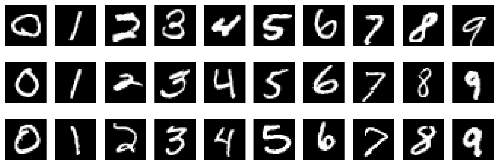
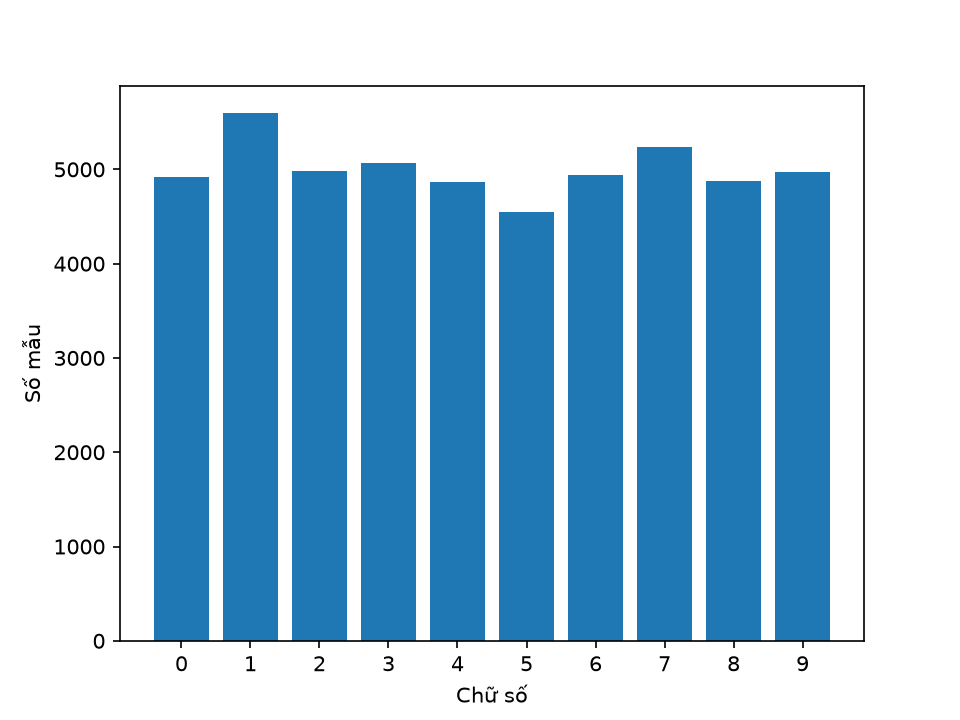
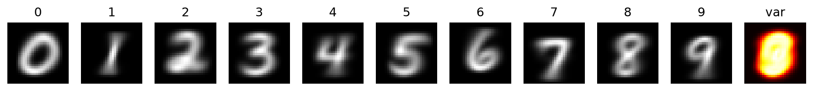
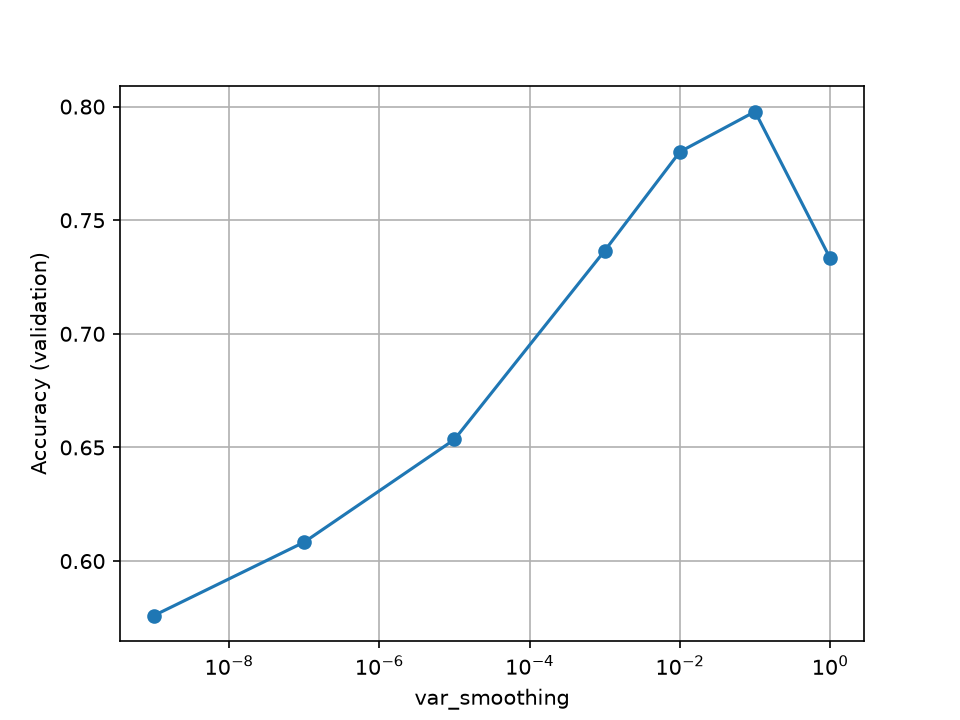
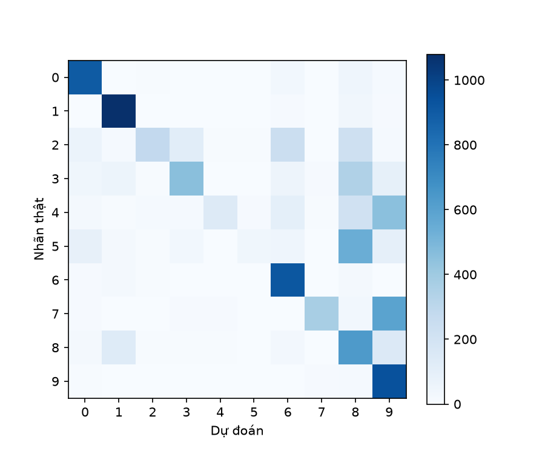
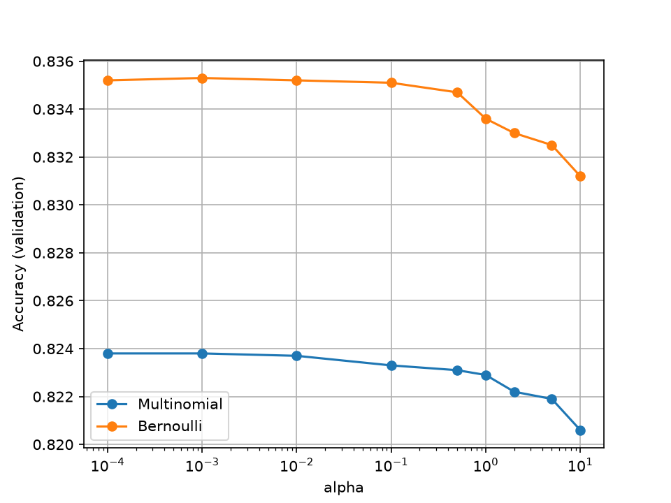
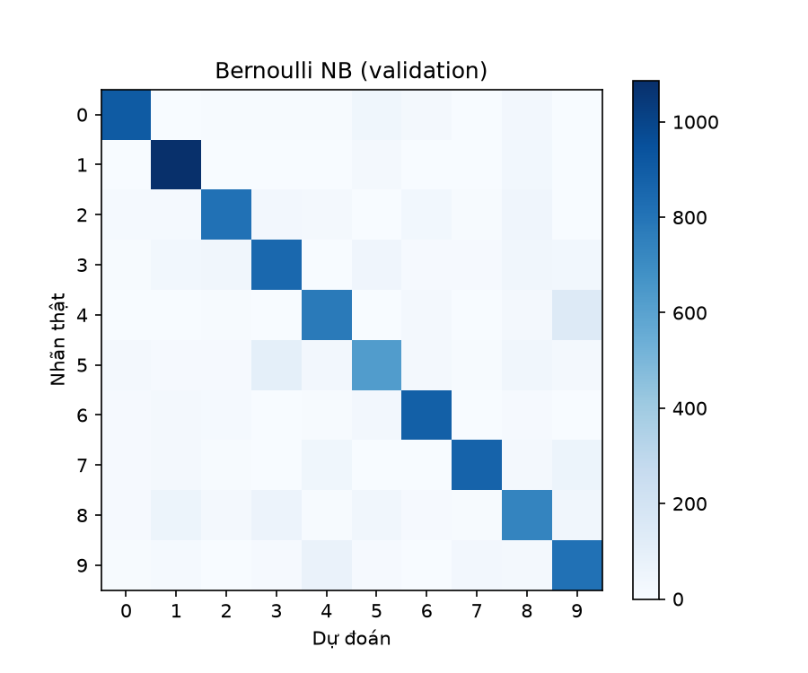

# Báo cáo đồ án 1: Nhận dạng chữ số viết tay bằng các phương pháp phân lớp

## 1. Dữ liệu

MNIST gồm 70.000 ảnh xám kích thước 28×28 của các chữ số từ 0 đến 9, trong đó có 60.000 ảnh huấn luyện và 10.000 ảnh kiểm thử. Chúng tôi tách 10.000 ảnh từ tập huấn luyện làm tập validation bằng hoán vị ngẫu nhiên với seed cố định 42, nên mọi thí nghiệm dùng chung cách chia 50.000 (train) / 10.000 (validation) / 10.000 (test).

Mỗi ảnh được làm phẳng thành vector 784 chiều và chuẩn hoá bằng cách chia cho 255 để đưa giá trị pixel về đoạn [0, 1]. Phép chia này dùng hằng số cố định, không dùng thống kê của tập nào, nên không gây rò rỉ dữ liệu (data leak) từ tập test.

## 2. Khám phá dữ liệu

Số mẫu mỗi lớp trong tập train dao động từ 4543 đến 5600 (xem hình bên dưới), tức các lớp gần cân bằng nên accuracy là độ đo hợp lý. Có khoảng 0.808802168367347% pixel bằng 0, và có 71 pixel luôn bằng 0 trên toàn tập train (phương sai bằng 0), nên khi cài Gaussian Naïve Bayes phải cộng một hằng số nhỏ ε vào phương sai để tránh chia cho 0.

## 3. Độ đo đánh giá

Chúng tôi tự cài confusion matrix bằng `np.bincount` và suy ra accuracy, precision, recall, F1 (macro) từ ma trận này. Kết quả được đối chiếu với scikit-learn trên dữ liệu ngẫu nhiên và khớp hoàn toàn (xem `tests/test_metrics.py`).

## Khai báo sử dụng AI

Nhóm có dùng trợ lý AI (Claude) để hỗ trợ lên lộ trình và gợi ý mã nguồn. Chúng tôi đã đọc, kiểm chứng và chịu trách nhiệm về toàn bộ mã nộp.
## 4. Gaussian Naïve Bayes

**Mô hình.** Giả sử các pixel độc lập có điều kiện theo lớp và mỗi pixel i của lớp c có phân phối chuẩn N(μ_ci, σ²_ci). Dự đoán chọn lớp cực đại hoá

log P(c) − ½ Σ_i log(2π σ²_ci) − ½ Σ_i (x_i − μ_ci)² / σ²_ci

**Huấn luyện.** Với mỗi lớp, tính prior, trung bình và phương sai từng pixel; cộng ε = var_smoothing × max(Var(X)) vào phương sai để tránh chia cho 0 vì có 71 pixel luôn bằng 0.

**Kết quả.** Với var_smoothing = 1e-9, accuracy validation là 57.6% (train 57.67%). Thời gian huấn luyện 0.437 s, dự đoán 0.575 s. Sau khi quét var_smoothing (hình bên dưới), giá trị 0.1 cho accuracy validation 79.78%. Kết quả đã được đối chiếu và khớp với sklearn (tham số và dự đoán).

**Nhận xét.** Accuracy thấp vì giả định độc lập giữa các pixel và phân phối chuẩn không đúng với ảnh chữ số: các pixel lân cận có tương quan mạnh, và giá trị pixel gần như nhị phân. Ưu điểm: huấn luyện rất nhanh (một lượt qua dữ liệu), dễ giải thích (mỗi lớp là một ảnh trung bình kèm độ phân tán).

## 5. Multinomial và Bernoulli Naïve Bayes

**Mô hình.** Multinomial NB coi giá trị pixel là số lần xuất hiện: θ_ci = (Σ x_i trong lớp c + α) / (Σ_i Σ x_i trong lớp c + α·d), và dự đoán chọn lớp cực đại hoá log P(c) + Σ_i x_i log θ_ci. Bernoulli NB nhị phân hoá pixel bằng ngưỡng 0,5, với p_ci = (số mẫu lớp c có pixel i sáng + α) / (số mẫu lớp c + 2α), và cực đại hoá log P(c) + Σ_i [x_i log p_ci + (1 − x_i) log(1 − p_ci)]. Cả hai đều dùng làm mịn Laplace với hệ số α để tránh log 0.

**Kết quả.** Với α = 1, Multinomial đạt 82,29% trên validation (train 82,45%, F1 macro 82,11%), Bernoulli đạt 83,36% (train 83,63%, F1 macro 83,13%). Thời gian huấn luyện lần lượt là 5,65 s và 2,49 s, dự đoán trên 10.000 ảnh validation là 0,023 s và 0,025 s. Khi quét α (hình bên dưới), giá trị tốt nhất của Multinomial là α = 1e-4 cho 82,38%, của Bernoulli là α = 1e-3 cho 83,53%. Kết quả đã được đối chiếu với sklearn: ma trận log xác suất đặc trưng của Multinomial NB trùng tuyệt đối (lệch tối đa 0), của Bernoulli NB lệch tối đa 1,8 × 10⁻¹⁵ (sai số làm tròn float64), log prior trùng khớp, và dự đoán trên validation trùng 100%.

**Nhận xét.** Accuracy của cả hai mô hình gần như không phụ thuộc vào α: trên toàn bộ khoảng α từ 1e-4 đến 10, Multinomial chỉ dao động từ 82,06% đến 82,38% (biên độ 0,32 điểm phần trăm) và Bernoulli từ 83,12% đến 83,53% (biên độ 0,41 điểm). Accuracy giảm rất nhẹ và đều khi α tăng, và đỉnh nằm ở α nhỏ (1e-4 đến 1e-3). Điều này trái với Gaussian NB, vốn rất nhạy với hệ số làm mịn (57,60% lên 79,78%). Một cách giải thích hợp lý là mỗi lớp có khoảng 5.000 mẫu nên số đếm của hầu hết pixel đủ lớn để α ≤ 10 gần như không đổi xác suất; α chỉ có tác dụng với số ít pixel hiếm khi sáng (vùng viền ảnh).

Cả hai mô hình tốt hơn Gaussian NB sau khi đã tinh chỉnh (79,78%), với Bernoulli hơn khoảng 3,7 điểm và Multinomial hơn khoảng 2,6 điểm, vì giá trị pixel MNIST gần như nhị phân, nên mô hình "sáng hay tối" hợp với dữ liệu hơn phân phối chuẩn. Bernoulli cao hơn Multinomial khoảng 1 điểm, phù hợp với việc nó còn dùng thông tin từ các pixel tối (phạt khi pixel tối ở nơi lớp đó thường sáng), trong khi Multinomial chỉ khai thác pixel sáng. Chênh lệch train và validation nhỏ (dưới 0,3 điểm) cho thấy hai mô hình không quá khớp mà bị giới hạn bởi giả định độc lập có điều kiện giữa các pixel.

## 6. Softmax Regression (bộ phân lớp tuyến tính)

**Mô hình.** Với ma trận đặc trưng X (N × 784), tham số W (784 × 10) và b (10), điểm số là Z = XW + b, xác suất lớp là P = softmax(Z), trong đó P_nc = exp(Z_nc) / Σ_j exp(Z_nj). Hàm mất mát là cross-entropy trung bình L = −(1/N) Σ_n Σ_c Y_nc log P_nc, trong đó Y là mã one-hot của nhãn.

**Gradient.** Với một mẫu, L_n = −Σ_c Y_c (Z_c − log Σ_j e^{Z_j}); do Σ_c Y_c = 1, đạo hàm theo Z_k là P_k − Y_k. Do đó ∂L/∂Z = (P − Y)/N, ∂L/∂W = Xᵀ(P − Y)/N và ∂L/∂b = tổng các hàng của (P − Y)/N. Khi thêm phạt L2 (λ/2)‖W‖², gradient theo W cộng thêm λW.

**Ổn định số.** Trước khi lấy exp, trừ max của từng hàng của Z, và tính log P qua Z − logsumexp(Z), để tránh tràn số và log(0).

**Kiểm chứng gradient.** Chúng tôi so sánh gradient giải tích với đạo hàm số (sai phân trung tâm, ε = 1e-5) trên 20 mẫu ngẫu nhiên, 300 phần tử ngẫu nhiên của W và toàn bộ b. Sai số tương đối tối đa là 1.22e-07 (λ = 0) và 3.43e-07 (λ = 0,1), tức gradient được cài đúng. Với W = 0, loss khởi đầu bằng 2.3025850929940463 ≈ ln 10 = 2,3026 như lý thuyết.

